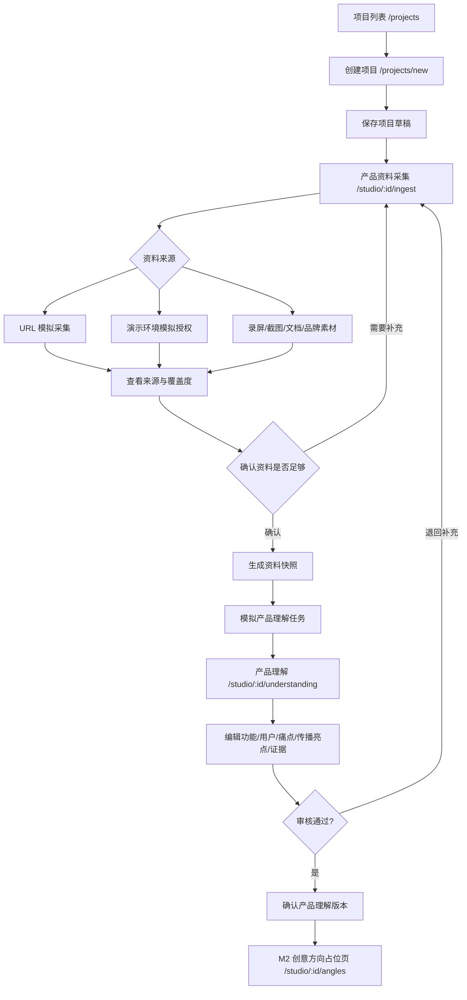

# VidCraft — M1 前端开发说明书：项目中心、产品资料采集与产品理解（Mock 版）

> **文档编号**：VC-FE-M1-001  
> **文档版本**：V1.0  
> **编制日期**：2026-11-06  
> **所属产品**：VidCraft — AI 创意营销视频 Agent  
> **技术基线**：M0 已完成；Vue Vben Admin 5.x、`apps/web-ele`（Element Plus）、Vue 3、TypeScript、Pinia、Nitro Mock、pnpm  
> **目标读者**：前端负责人、前端工程师、UI/UX 设计师、测试工程师、后端/Agent 接口负责人  
> **开发性质**：前端业务页面 + 可交互 Mock 数据闭环；**不接入真实网页爬取、浏览器远程登录、真实 AI、视频生成、支付或 FFmpeg**。  
> **相关文档**：`VidCraft_M0_Vben工程基础搭建指南.md`、`AI创意营销视频Agent_前端研发说明书_Mock版_v1.0.md`。

---

# 0. 必须先读：M1 要实现什么、不实现什么

## 0.1 一句话任务

用户进入 VidCraft，能够从项目列表创建一个营销视频项目，提交**URL / 授权演示环境 / 产品录屏 / 截图 / 产品文档 / 品牌素材**中的一种或多种资料，查看**模拟采集、来源和证据**，让模拟 Agent 输出“产品理解 + 目标用户 + 潜在痛点 + 反常规创新价值 + 待验证事项”，由用户**修改、补充、确认**后进入 M2「创意方向发现」。

**本阶段关注的是产品输入与理解的可控性，不是生成宣传视频。** 后续 M2 才围绕产品传播切口生成 3 套差异化创意方向；M3 才做单镜头生成与计费；M4 才做整片合成。M1 数据结构必须能够支持这些后续步骤。

## 0.2 M1 交付流程（必须从头走通）



## 0.3 M1 页面交付清单

| 编号 | 路由 | 页面 | 布局 | M1 交付等级 |
|---|---|---|---|---|
| P1 | `/projects` | 项目列表、搜索/筛选/操作 | Vben 标准布局 | **P0 必须** |
| P2 | `/projects/new` | 新建项目向导与草稿 | 标准/简化布局，沿用 M0 | **P0 必须** |
| P3 | `/projects/:id` | 项目详情与当前进度 | Vben 标准布局 | P1，推荐 |
| P4 | `/studio/:id/ingest` | 多来源产品资料采集 | M0 自定义 Studio 布局 | **P0 必须** |
| P5 | `/studio/:id/understanding` | AI 产品理解、证据、用户痛点、人工复核 | Studio 布局 | **P0 必须** |
| P6 | `/studio/:id/angles` | M2 创意方向占位与通过审核后的跳转 | Studio 布局 | P0 路由衔接即可 |
| P7 | `/dashboard` | 项目创建快捷入口和最近项目 | M0 标准布局 | P1，小幅改动 |

## 0.4 M1 不做，但必须预留

- 不抓取任何真实 URL；仅模拟公开网页分析与来源摘要。
- 不实际登录第三方网站；模拟授权对话框**不接受真实密码**，不保存 Cookie、Token、账号凭据。
- 不真正抽帧、做 OCR、语音识别或文档解析；仅展示 Mock 分析摘要。
- 不调用 Qwen、豆包、Seedance、可灵或其他收费 AI API。
- 不生成视频、图片，也不修改模型参数；图文分镜属于 M2。
- 不做真实积分冻结、结算、支付；M1 可以显示视频预计属于后续计费阶段的说明。
- 不实现复杂视频时间线、音频编排、FFmpeg 合成。
- 不允许跳过产品理解确认直接进入可生成收费视频的后续阶段。

## 0.5 与 M0 的衔接规则：这是项目既定约定，不得自行改名

M0 已经存在以下工程契约：

- 前端应用：`apps/web-ele`（Element Plus），不创建第二套 Vue 项目。
- Mock 服务：优先沿用 `apps/backend-mock` 的 Nitro 模式，不在各 Vue 组件中直接写死响应。
- 业务接口根路径：浏览器 `/api/creative-video/v1`；业务 Service 相对路径 `/creative-video/v1`。
- 业务响应体：`{ code: 'OK', message, data, requestId, timestamp }`；**注意与 Vben 登录接口可能使用的 `code: 0` 不同**，使用 M0 的专用 API 适配层。
- 核心路由：`/projects/new`、`/studio/:id/ingest`、`/studio/:id/understanding`；**不要改为 `/projects/create`、`/studio/:id/sources`**。
- 角色：`owner / editor / reviewer`（可预留 viewer/admin）。
- M0 四个 Seed 项目及其 ID 固定，不得随意替换。
- Mock Banner、中文、错误/空态组件、独立 Studio 全屏布局沿用 M0。
- 业务 TypeScript 类型、RequestClient、路由、Pinia 约定优先复用 M0 现有实现。

若 M0 已交付代码与本文示例目录有差异，以**实际已经验收的 M0 工程**为准；只改业务扩展点，不反向重构底座。对于路由历史书签，允许添加从旧试验路径到标准路径的重定向，但不要维护两套业务页面。

---

# 1. 产品业务语义：设计师与工程师必须理解

## 1.1 VidCraft 的目标不是“网页转操作教程”

用户给出一个 SaaS/网站 URL，VidCraft 未来要发现这个产品的独特传播价值，例如：

- **反常规创新**：传统 PDF/Word 简历 → 可以交互的 3D 网页简历。
- **真实痛点**：大量收藏文章 → 需要用时找不到 → AI 知识库帮助快速定位。
- **结果反差**：传统 CRM 跟进混乱 → 销售提醒/流程透明（能力必须经资料确认）。
- **身份表达**：普通个人介绍 → 更鲜明的数字化个人品牌。
- **视觉惊喜/现场演示**：静态图片 → 3D 交互体验（必须是产品实际支持的能力）。

M1 的职责是提供足够扎实、可溯源的**产品事实、目标受众、使用场景、可能痛点与差异化线索**。不要在 M1 就直接强行套入某个广告模板，更不能把 AI 假设当作已验证事实。

## 1.2 价值切口和表达风格是不同概念

- 产品价值切口：为什么这个产品值得关注，例如「旧 PDF → 3D 网页」。
- 内容表现形式：如何让观众看下去，例如悬念、搞笑、视觉奇观、故事反转、动态排版。
- M1 输出**价值线索**；M2 才生成并评审完整的创意营销提案。

## 1.3 对真实信息保持审慎

每条产品功能、用户痛点、收益宣称必须显示信息来源或证据等级：

| 等级 | 字段值 | 解释 | M1 UI 表现 |
|---|---|---|---|
| 已核实资料 | `verified` | 资料直接支持，例如产品说明或功能页面 | “有资料依据”；可打开来源 |
| 所有人确认 | `user_confirmed` | 产品方人工确认事实，尚非独立市场实证 | “客户已确认” |
| AI 推测 | `hypothesis` | 合理但未经验证的可能需求/痛点 | “待验证”；默认不能写成确定性宣传语 |
| 缺乏依据 | `unsupported` | 没有支持或与资料冲突 | “不可作为确定性主张” |

**禁止**把“减少 80% 成本”“保证获客”“已有 10 万客户”等未经证实的数字自动当成事实。

---

# 2. 信息架构、导航、状态和权限

## 2.1 项目主要阶段与 M1 范围

完整流程：

`S1 资料 → S2 理解产品 → S3 创意方向 → S4 剧本 → S5 图文分镜 → S6 预演 → S7 镜头视频 → S8 成片`

M1 只开发 S1、S2 的完整交互，S3 保留带说明的占位。Studio 顶部 8 步导航应保持一致。S1/S2 未确认时，后续步骤不能作为可执行的完整业务直接进入。

## 2.2 页面进入逻辑

| 入口 | 操作 | 跳转 |
|---|---|---|
| `/dashboard` | 点击“新建营销视频” | `/projects/new` |
| `/projects` | 点击新建项目 | `/projects/new` |
| `/projects/new` | 成功创建 | `/studio/{id}/ingest` |
| `/projects` | 点击进行中的项目 | 根据项目 currentStage / lastVisitedStage 进入 |
| `/studio/{id}/ingest` | 点击确认资料并模拟分析 | `/studio/{id}/understanding`，显示任务中状态 |
| `/studio/{id}/understanding` | 审核通过 | `/studio/{id}/angles` M2 占位 |
| `/studio/{id}/understanding` | 请求补充资料 | `/studio/{id}/ingest` |

新建项目成功后不要仅仅停在一个“创建成功”弹窗；必须进入资料采集。

## 2.3 项目状态

保留 M0 核心字段：

```ts
export type ProjectStage =
  | 'INGEST' | 'UNDERSTANDING' | 'ANGLES' | 'SCRIPT'
  | 'STORYBOARD' | 'ANIMATIC' | 'GENERATE' | 'RENDER';

export type ProjectStatus =
  | 'DRAFT' | 'IN_PROGRESS' | 'WAITING_REVIEW'
  | 'COMPLETED' | 'ARCHIVED';
```

M1 的细粒度状态**通过阶段详情对象表示**，不要擅自给 `ProjectStatus` 增加十多个互相冲突的值：

```ts
export type IngestionStatus =
  | 'EMPTY' | 'COLLECTING' | 'READY_TO_CONFIRM'
  | 'CONFIRMED' | 'STALE';

export type UnderstandingStatus =
  | 'NOT_STARTED' | 'QUEUED' | 'RUNNING'
  | 'DRAFT_READY' | 'WAITING_REVIEW' | 'APPROVED'
  | 'FAILED' | 'STALE';
```

- `project.currentStage` 用于导航当前位置，不等同于任务是否成功。
- `project.status` 用于列表的总体展示。
- `ingestion.status / understanding.status` 用于页面专属操作门禁。
- `lastVisitedStage` 记录最后访问页面（建议字段），刷新后可以继续。

## 2.4 权限矩阵

| 操作 | owner | editor | reviewer | viewer（预留） |
|---|:---:|:---:|:---:|:---:|
| 查看项目列表/详情 | ✓ | ✓ | ✓ | ✓ |
| 创建项目 | ✓ | ✓ | — | — |
| 编辑项目/视频规格 | ✓ | ✓ | — | — |
| 上传/删除项目资料 | ✓ | ✓ | — | — |
| 启动采集和模拟分析 | ✓ | ✓ | — | — |
| 查看采集证据、理解报告 | ✓ | ✓ | ✓ | ✓ |
| 修改理解报告 | ✓ | ✓ | — | — |
| 批注/提出审核意见 | ✓ | ✓ | ✓ | — |
| 最终确认理解报告 | ✓ | 按项目授权 | ✓（若授予审核权） | — |
| 删除/归档项目 | ✓ | 项目明确授权时 | — | — |
| 模拟授权/撤销演示访问 | ✓ | ✓ | — | — |

**前端按钮限制 + Mock API 403 同时实现**；仅在页面隐藏按钮并不算权限管理。管理员角色并不应天然看到用户演示凭据；M1 根本不保存该类凭据。

## 2.5 未保存编辑和离开页面

- 有脏数据时，点击“返回项目中心”、切换步骤、关闭路由前，显示“有未保存修改”的确认对话框。
- 编辑类表单建议支持显式“保存草稿”；可以辅助防抖自动保存，但必须显示“保存中 / 已保存 / 保存失败”。
- 浏览器整页关闭或重启不能绝对保证保存成功，避免虚假“全部自动保存”文案。
- 资料确认后，如果新增、删除或替换会影响分析的素材，标记理解结果 `STALE` 并提示重新分析或重新审核，不能悄悄沿用旧报告。

---

# 3. P1 项目列表页 `/projects`

## 3.1 页面目的

让用户快速查找、继续、创建和管理营销项目；M0 四个 Seed 可见，新建项目也要进入列表，刷新后状态保持。页面不能仅有一张静态表。

## 3.2 页面布局（建议）

```text
┌ 顶部：项目中心                                     [新建营销视频] ┐
│ 最近编辑 / 我的项目 / 已归档                                       │
│ [搜索项目名或产品] [阶段筛选] [状态筛选] [平台] [排序] [卡片|表格] │
├──────────────────────────────────────────────────────────────────┤
│ 封面 | 项目名 | 产品URL | 当前阶段 | 时长 | 平台 | 最近更新 | 操作 │
│ 3D网页简历      S5 图文分镜     120s    抖音           [继续][···]│
│ AI知识库        S2 产品理解      30s    视频号         [继续][···]│
│ CRM             S1 资料采集      60s    B站            [继续][···]│
│ VidCraft        S3 创意方向      45s    抖音           [继续][···]│
├──────────────────────────────────────────────────────────────────┤
│ 共 N 个项目       < 1 2 3 >                                      │
└──────────────────────────────────────────────────────────────────┘
```

## 3.3 必须展示的字段

| 字段 | 展示 | 说明 |
|---|---|---|
| `title` | 项目名 | 点击可进入详情或继续 |
| `productName` | 产品名 | 可与项目名不同 |
| `productUrl` | 截断 URL + 打开图标 | 无 URL 时显示“仅上传资料” |
| `coverAssetId` | 封面 | 没有时使用项目默认封面，避免破图 |
| `durationSec` | 30/45/60/120 秒 | 使用真实配置，不臆造生成长度 |
| `aspectRatio` | 9:16 / 16:9 / 1:1 | 与项目表单一致 |
| `platforms` | 标签列表 | 单平台兼容 M0 `platform` |
| `currentStage` | 当前阶段 | Stage 字典统一映射 |
| `stageReviewState` | 待确认/进行中/已确认 | 通过细粒度阶段汇总衍生 |
| `updatedAt` | 最近更新 | 按当前 UI 时区展示 |
| `ownerId` | 项目所有人 | 模拟身份 |
| `status` | 草稿/制作中/已完成/归档 | 项目状态 |

## 3.4 必须实现的操作

1. **新建**：跳转 `/projects/new`。
2. **搜索**：按项目名、产品名、URL 模糊搜索；输入防抖 250～400ms；支持清空。
3. **筛选**：阶段、状态、平台；重置筛选。
4. **排序**：最近更新（默认）、创建时间、名称。
5. **分页**：page/pageSize/total 来自 Mock API；页数越界时恢复合法页。
6. **卡片/表格视图**：同一数据源，不得两份状态。
7. **继续编辑**：跳转最后需要处理的阶段，已归档项目只读。
8. **重命名**：对话框校验名称，PATCH 并带版本号；成功更新 UI。
9. **复制**：新 ID、新项目草稿，复制基础配置和资料元数据；不可默认复制授权会话或真实账号；可选是否关联已有素材引用。
10. **归档/恢复**：状态可逆，权限符合矩阵。
11. **软删除**：必须二次确认，默认列表移除；Mock 可提供“已删除”演示筛选或管理员恢复机制。
12. **异常与反馈**：空列表、网络失败、权限不足、修改冲突、删除失败都有可恢复界面。

**账务注意**：未来删除或复制项目不得删改既有账务流水。M1 可以在确认框中说明，当前没有真实账务。

## 3.5 交互细节

- 归档项目点击继续时，提示“项目已归档，恢复后可编辑”。
- 删除项目需要验证用户权限，不能在前端删除成功后才发现服务端拒绝。
- 列表请求进行中显示骨架屏，不闪动空状态。
- 点击 URL 打开外部网站必须显式用户动作，并带新窗口安全属性；不要在 Mock 自动访问外部网址。
- 无权限操作隐藏或禁用并说明理由；后台依旧返回 403。
- 批量操作为 P1，可延后；不要在 P0 引入复杂选中状态。

## 3.6 页面验收

- M0 四个 Seed 全部显示，新项目创建后可见。
- 可以搜索、筛选、继续、重命名、归档、恢复、复制、软删。
- 浏览器刷新后，当前状态和服务端 Mock 保持一致。
- `reviewer` 无法创建/修改；Mock 直接调用也必须被拒绝。
- 不存在的项目 ID 不能跳到空白 Studio。

---

# 4. P2 新建项目 `/projects/new`

## 4.1 页面目标和交互取舍

M1 推荐做 **“基础信息 → 营销要求 → 资料授权说明”** 的分组表单，也可用不超过 3 个步骤的向导。不要在用户仅仅创建项目时要求其填写大量市场研究材料；可以选“交给 AI 判断”。

核心目标：**最快方式创建可编辑的项目草稿，然后到 Studio 补充资料。**

## 4.2 表单字段级规格（必须按此设计校验）

| 分组 | 字段（TypeScript） | 控件 | 必填 | 规则及默认 |
|---|---|---|---|---|
| 基础 | `title` | Input | 是 | 1～100 字符；去首尾空格；默认空 |
| 基础 | `productName` | Input | 否 | 1～100 字符；可从网站分析后补齐 |
| 基础 | `description` | Textarea | 否 | 最多 2000 字符 |
| 资料入口 | `productUrl` | Input | 条件 | http/https 格式；无 URL 时必须通过后续素材补充资料 |
| 目标 | `market` | Select | 是 | `CN`（默认）/`GLOBAL`/`OTHER` |
| 目标 | `targetAudience` | Textarea | 否 | 最多 1000 字；可留空由 Agent 推断 |
| 目标 | `marketingObjective` | Select | 是 | `awareness`/`signup`/`purchase`/`launch`/`traffic`，默认 `signup` |
| 渠道 | `platforms` | 多选 | 是 | 抖音、视频号、B站、TikTok、官网、销售介绍、其他；至少 1 项 |
| 视频规格 | `durationSec` | Radio/Select | 是 | 15、30、45、60、90、120；如支持自定义，需设上限及合法区间 |
| 视频规格 | `aspectRatio` | Segmented/Radio | 是 | 9:16（默认）/16:9/1:1 |
| 视频规格 | `language` | Select | 是 | 默认 `zh-CN`；其他可置为预留 |
| 风格 | `stylePreferences` | 标签多选 | 否 | 反常规、痛点共鸣、幽默、视觉冲击、电影感、3D、MG、故事反转，默认空即由 Agent 判断 |
| 风格 | `negativeGuidance` | Textarea | 否 | 最多 1000 字，如“不要做操作说明”“不要过早硬广” |
| 授权 | `rightsConfirmed` | Checkbox | 是 | 用户声明有权使用网址与上传资料、授权演示系统；不允许自动勾选 |

**创建合法性规则**：允许用户**有 URL**、**先建空草稿后补充资料**或**仅以资料创建**。不允许在创建时就因暂时缺少 URL 而阻塞“保存草稿”；但在 S1 “开始产品分析”前必须至少有一个有效来源。

`productUrl` 不支持 `javascript:`、`file:`、`data:`、`localhost` 等作为自动分析目标；真实系统必须由服务端再做 SSRF、私有 IP、重定向及云元数据拦截。M1 是前端模拟，不应以客户端检查宣称已具备服务端安全能力。

## 4.3 UI 设计（参考结构）

```text
┌─────────────────────── 新建 AI 营销视频项目 ────────────────────────┐
│ 项目基础信息                                                       │
│ 项目名称* [__________________________________]                    │
│ 产品名称  [__________________________________]                    │
│ 产品 URL [https://___________________________]  [稍后补充资料]     │
│ 产品简介 [____________________________________________________]   │
│                                                                    │
│ 宣传目标与受众                                                     │
│ 营销目标 [吸引注册 ▼]  目标市场 [中国大陆 ▼]                      │
│ 目标用户 [可交给 AI 判断____________________]                      │
│ 目标平台 [✓ 抖音] [✓ 视频号] [ B站 ] [ TikTok ]                    │
│                                                                    │
│ 影片要求                                                           │
│ 时长 [15][30][45][60][90][120]  比例 [9:16][16:9][1:1]           │
│ 风格 [交给 AI 发现最佳传播切口] [3D] [搞笑] [故事性] ...           │
│ 创作禁区 / 偏好 [__________________________]                       │
│                                                                    │
│ □ 我有权使用提交的产品资料，理解授权演示的相关要求                 │
│ [取消]                           [保存草稿] [创建并采集资料]       │
└────────────────────────────────────────────────────────────────────┘
```

## 4.4 主要按钮规则

| 操作 | 规则 |
|---|---|
| 保存草稿 | 最小条件：合法项目名称、授权确认（若已提供受保护素材）；允许 URL 为空；记录 `DRAFT` |
| 创建并继续 | 创建成功自动进入 `/studio/:id/ingest`，可以没有资料，但提示补充 |
| 取消 | 无编辑时返回项目列表；有脏数据必须确认 |
| 重复提交 | 提交期间禁用，后端 `Idempotency-Key` / mock 幂等键避免双建项目 |
| 创建失败 | 保留输入内容，显示错误及重试，不发生重复创建 |
| 选择 120 秒 | 显示提示“后续创意导演会评估时长是否合适”，不强制短片脚本拉长 |
| 多平台 | 建议以首选发布平台决定第一版比例，可允许用户覆盖并提示其他平台的裁切风险 |

说明：`rightsConfirmed` 是本地模拟授权声明，**不等于**第三方网站登录授权；真实远程浏览器登录要有独立的授权流程。

## 4.5 Mock 提交行为

```text
点击“创建并继续”
  → 校验字段
  → POST /projects（使用业务 API Service）
  → 返回项目 id / version 1 / currentStage INGEST
  → 显示“项目创建成功”
  → router.push('/studio/' + id + '/ingest')
```

## 4.6 错误状态

- 空项目名、超长名称、无效 URL、未选平台、无效时长、缺少必要授权确认。
- 409 幂等键冲突（同键不同请求），应提示重新发起请求而非创建未知项目。
- 网络超时导致结果未知时，应支持按幂等键查询结果，不直接无限重试创建。
- reviewer 调用创建 API 返回 403。
- API 500/503、请求失败时显示可重试状态，表单不清空。

---

# 5. P3 产品资料采集 `/studio/:id/ingest`

## 5.1 页面定位

这里是 M1 最重要的输入工作台。不能把它做成单纯的“上传文件”表单。用户需要明确知道：**Agent 已经看到了什么、没看到什么、哪些功能了解可靠、下一步还需要补充什么。**

## 5.2 页面布局

```text
┌ 返回项目 | 项目名称 | 资料 [当前] → 理解 → 创意 → 剧本 → 分镜 ...┐
├──────────────────────────────────────────────────────────────────┤
│ 左侧来源导航           │ 中央资料操作/预览      │ 右侧完整度/待补充 │
│ ● 网站 URL             │ [输入URL/模拟分析]      │ 已知核心功能  ✓  │
│ ● 演示系统              │ 采集事件与页面卡片      │ 目标用户      ?  │
│ ● 产品录屏             │ 授权会话/探索页面        │ 产品真实画面  ✓  │
│ ● 产品截图             │ 文件上传/进度/预览      │ 真实用户评价  -  │
│ ● 产品说明             │ 证据列表/摘要           │ 宣传禁区      ?  │
│ ● 品牌资料             │                         │                  │
│                       │                         │ [保存资料]       │
│                       │                         │ [确认并开始分析] │
└──────────────────────────────────────────────────────────────────┘
```

Studio 左侧资料分类是**创作工作台内部的二级导航**，不能恢复 Vben 传统后台侧边菜单。

## 5.3 支持的六类资料

| 来源 | 数据输入 | Mock 结果 | 备注 |
|---|---|---|---|
| 公开网址 | URL + 可选页面范围 | 页面列表、截图缩略图、摘要、功能证据 | 模拟，不访问真实 URL |
| 演示环境 | 演示地址、授权动作 | 模拟会话、探索页面/功能树、到期/撤销 | 不收真实密码 |
| 产品录屏 | MP4/MOV/WebM 等 | 素材元数据、封面、时间戳片段摘要 | 模拟内容理解 |
| 产品截图 | PNG/JPG/WebP | 缩略图、图片说明、来源标签 | 可多选 |
| 产品文档 | PDF/DOCX/TXT/MD/PPTX | 文件列表、页码引用、模拟解析摘要 | 不伪装真实解析 |
| 品牌资料 | Logo、品牌色、宣传禁区、参考广告 | 品牌卡、可使用素材列表 | 后续视觉规范使用 |

每份资料必须有 `sourceId`，每一条产品事实可引用 `evidenceId`。后续 M2 的创意可追溯至 M1 的证据，不要把资料统一拍平成一段大文本。

## 5.4 URL 模拟采集的状态机

```ts
export type UrlCollectionStatus =
  | 'NOT_STARTED'
  | 'FETCHING'
  | 'PUBLIC_SUCCESS'
  | 'PARTIAL'
  | 'LOGIN_REQUIRED'
  | 'FETCH_FAILED';
```

| 状态 | 页面表现 | 主要操作 |
|---|---|---|
| `NOT_STARTED` | 请输入 URL / 使用已有资料 | 开始分析 |
| `FETCHING` | 事件时间线、模拟进度、“Mock 分析中” | 允许离开后恢复；在可取消阶段取消 |
| `PUBLIC_SUCCESS` | 页面卡片、摘要、证据列表 | 查看、确认、追加来源 |
| `PARTIAL` | 已采集内容 + 明确缺失页面 | 补充文档/截图/演示授权 |
| `LOGIN_REQUIRED` | 登录门槛提示 | 模拟授权或上传录屏 |
| `FETCH_FAILED` | 失败原因、重试与替代输入方式 | 重试/跳过/上传资料 |

模拟阶段事件示例：

```json
[
  { "step": "discover_home", "label": "识别网站首页", "status": "SUCCEEDED" },
  { "step": "extract_features", "label": "提取公开功能描述", "status": "SUCCEEDED" },
  { "step": "check_login", "label": "检查登录门槛", "status": "SUCCEEDED" },
  { "step": "build_evidence", "label": "整理来源证据", "status": "RUNNING" }
]
```

**不允许**在页面上写“已真实访问网站”“已登录客户系统”等与 Mock 实际行为不一致的提示。统一显示“模拟分析结果 / 演示数据”。

## 5.5 URL 分析操作

1. 先展示待分析的 URL，允许修改、取消。
2. 点击模拟采集，调用异步任务 API，返回 `jobId`。
3. 前端根据 `jobId` 轮询或订阅 Mock 事件，显示阶段事件。
4. 成功后显示至少首页、产品功能页、常见问题/关于页等**模拟来源卡片**；这些卡片是依据 fixture，不允许假装已经访问用户新输入的任意真实网站。
5. 新输入的非 Seed URL：返回**通用待验证的 Mock 结果**，标明“尚未真实读取该站点，请上传资料验证”；不应硬塞 3D 简历产品的数据。
6. `LOGIN_REQUIRED` 时突出提示“仅登录后的功能无法通过公开页面确认”。
7. `FETCH_FAILED` 时提供“尝试重试 / 上传产品资料 / 稍后处理”。
8. 支持把某个来源标记为“无效/不参与分析”，但保留操作历史。

## 5.6 演示环境授权（Mock 安全规范）

### 5.6.1 真实产品未来应采取的流程（M1 不实现）

未来：用户进入隔离的浏览器会话 → 用户自行登录演示系统 → Agent 在限定域名、限定权限、模拟数据下探索 → 证据脱敏 → 会话到期或撤销。实际账号凭据必须在安全服务端处理，不进入 LLM 输入或前端浏览器持久化存储。

### 5.6.2 M1 仅实现模拟授权界面

- 按钮：“打开演示环境授权（模拟）”。
- 明确写“这是 Mock 授权演示，不会连接或登录真实网站”。
- 仅展示只读的示例账号标识 `demo_viewer`，**不提供真实密码输入框**，不调用第三方网站。
- 点击“模拟授权成功”创建会话摘要：`sessionId`、`scopeDomains`、`readOnly=true`、`issuedAt`、`expiresAt`、`status`。
- 授权范围提示：域名白名单、仅模拟读取、不执行删除/付款/客户数据导出等高风险操作。
- 模拟探索过程：登录页 → 仪表盘 → 功能列表 → 功能详情，每个节点有固定示例截图/摘要。
- 支持“模拟授权失败”“过期”“需要 MFA”“权限不足”“没有演示数据”“撤销授权”。
- 会话过期后不能再标记为 `ACTIVE`，已采集的来源证据可保留但注明对应会话过期。
- 不把任何敏感凭据放入 console、请求体、URL Query、LocalStorage、Mock Seed、日志和截图。

### 5.6.3 授权状态

```ts
export type DemoSessionStatus =
  | 'NONE' | 'AUTHORIZING' | 'ACTIVE' | 'EXPIRED'
  | 'REVOKED' | 'MFA_REQUIRED' | 'ACCESS_DENIED' | 'NO_DEMO_DATA';
```

## 5.7 上传资料交互（必须完整可点）

**支持**：拖拽、多文件选择、类型/大小校验、进度展示、取消、重试、删除、预览、重命名、用途分类、关联备注。

建议初始限制（未来与后端协商，当前是 UI 配置）：

| 类型 | 格式 | 单文件大小上限 | Mock 行为 |
|---|---|---:|---|
| 图片 | JPG/PNG/WebP | 20 MB | 缩略图 / 本地预览 |
| 录屏视频 | MP4/WebM/MOV | 500 MB | 元数据 / 浏览器支持时预览 |
| 产品文档 | PDF/DOCX/TXT/MD/PPTX | 50 MB | 显示文件名/大小/模拟文本摘要 |
| Logo | PNG/JPG/WebP | 20 MB | 品牌区域预览 |

每项目建议上限 100 个资源（配置项），可在模拟文件上传时人为切换服务器拒绝场景。

**本地预览原则**：

- 可使用 `URL.createObjectURL(file)` 预览用户本地文件；组件卸载后 `URL.revokeObjectURL()`。
- 浏览器刷新后 `blob:` URL 会失效：**不能**将该 blob URL 持久保存为真实可复原媒体路径。
- M1 可采用 `IndexedDB` 保存非敏感演示素材内容（带总容量限制），或只保存 Mock 元数据并在刷新后显示“请重新选择本地文件”。必须由团队明确选择一种方案并测试。
- Mock 后端不可声称已真实持久化文件内容，除非团队确实实现了有容量上限和清理机制的开发期文件存储。
- 上传 `MOV` 或无法播放的容器时显示“浏览器不支持预览，可继续保存元数据”，不要报页面错误。
- 不接受 SVG/HTML 当成可直接执行的页面或无审查的预览内容；不要将用户文件自动传到第三方云图床。
- 类型检查同时看扩展名和 MIME（两者都不应被当作真正的安全扫描）。

### 5.7.1 单素材状态

```ts
export type AssetUploadStatus =
  | 'SELECTED' | 'VALIDATING' | 'UPLOADING'
  | 'SUCCEEDED' | 'FAILED' | 'CANCELLED' | 'NEEDS_RESELECT';
```

### 5.7.2 常见异常

- 文件大小超限、格式不支持、同名文件、模拟网络失败、用户取消。
- 大文件上传进度停止时，不可一直显示 99% 而不给出后续状态。
- 失败的文件只显示“重试”，成功的文件不应被重复创建记录。
- 删除一个已被资料快照引用的文件时，应提示理解报告可能需重做，并保留快照的版本历史与缺失引用警告。

## 5.8 产品资料覆盖度面板

以**项目已知信息是否充足**为核心，而不是纯粹比文件数量。

| 检查项 | 状态 | 说明 |
|---|---|---|
| 产品定位 | 已确认 / 待验证 / 缺失 | 是什么产品 |
| 核心功能 | 已确认 / 待验证 / 缺失 | 功能与价值 |
| 目标用户 | 已确认 / 待验证 / 缺失 | 谁会使用 |
| 真实界面 | 已确认 / 待验证 / 缺失 | 是否有截图/录屏 |
| 品牌资料 | 已确认 / 待验证 / 缺失 | Logo、颜色和口吻 |
| 用户痛点证据 | 已确认 / 待验证 / 缺失 | 用户访谈/案例/资料 |
| 产品宣传禁区 | 已确认 / 待验证 / 缺失 | 不允许使用的主张 |

不要求七项全部齐全才能分析。例如只有公开官网也能分析，但必须在理解报告中标注较低置信度，并提示补充来源。**只有完全没有有效资料时**才禁止“开始分析”。

## 5.9 “保存资料 → 确认快照 → 开始产品分析”

建议明确分离两个操作：

1. **保存资料**：随时保存，允许持续补充。
2. **确认当前资料并开始分析**：计算/记录不可变的 `ingestionSnapshotId`，提交一条 `understanding` 模拟任务，进入 S2。

提交前的确认摘要包含：参与分析的 URL、素材数、演示授权摘要、缺失事项、包含待验证数据的提示。

确认之后并不禁止补充资料，但新资料不会偷偷修改旧快照；更新资料需要**新快照 + 新理解修订**。即使用户暂时继续使用旧报告，也要显示“部分分析可能过时”。

---
# 6. P4 产品理解与用户洞察 `/studio/:id/understanding`

## 6.1 页面意义

**这是 M1 的最终交付和第一道真正的人工审核关卡。**

用户不是来读一篇未经验证的 AI 报告，而是要判断：Agent 是否真的看懂产品、是否误判功能、哪些痛点只是推测、有哪些“非常规价值”值得下一阶段创意导演研究。

M1 完成时，用户应能够对分析结果进行**查看 → 编辑 → 驳回 → 补充证据 → 重新分析 → 确认版本**的完整闭环。

## 6.2 画面结构（建议三栏）

```text
┌ 返回项目 | 产品资料 ✓ → 产品理解 ● → 创意方向(锁定) → ... ┐
├────────────────┬────────────────────────────────┬──────────────────┤
│ 左：证据来源    │ 中：AI 理解报告                 │ 右：审核/修改    │
│ 官网 /功能页    │ 产品一句话定位                  │ 产品理解准确?   │
│ 演示页 /录屏    │ 目标受众 / 使用场景              │ [提出修改意见]  │
│ 文档页码/截图   │ 核心功能 / 事实依据              │ [添加遗漏功能]  │
│ [来源筛选]      │ 传统方式 vs 当前产品             │ [禁用某主张]    │
│ [时间戳预览]    │ 5个潜在痛点 / 情绪 / 成本        │ [重新分析部分]  │
│                 │ 非寻常创新 / 身份 / 结果价值     │                  │
│                 │ 不确定事项 / 缺失信息           │ 当前报告 R1     │
├────────────────┴────────────────────────────────┴──────────────────┤
│ [返回补充资料] [保存修改草稿] [AI 重新分析] [确认产品理解，进入创意] │
└──────────────────────────────────────────────────────────────────┘
```

**移动端**：可降级为标签/抽屉，但桌面 1366px～1920px 应优先保证证据和审核方便对照；设计不应简单用大表单从上到下堆砌。

## 6.3 报告必备的 10 个区块

| 区块 | 必须展示的信息 | 用户可操作内容 |
|---|---|---|
| 1. 产品定位 | 一句话、行业、业务类型、主要用途 | 直接编辑、补充 |
| 2. 目标人群 | 使用者、购买者、行业、典型场景 | 删除不准画像、增加用户群 |
| 3. 核心功能 | 名称、实际作用、可见效果、对应来源 | 修改、确认、标记不支持 |
| 4. 传统替代方案 | 以前怎么做、现在怎么做 | 修改、补充替代方式 |
| 5. 用户痛点 | **不少于 5 个候选**，包含人物、场景、困扰、情绪 | 逐项确认、驳回、改写 |
| 6. 产品价值映射 | 痛点 → 产品功能 → 用户能得到什么 | 查看关联、修正映射 |
| 7. 非寻常创新 | 旧方式 vs 新方式，“原来还可以这样” | 标记是否真实、是否值得传播 |
| 8. 其他价值线索 | 结果反差、身份认同、现场惊艳、愿景等 | 收藏到下一阶段候选集 |
| 9. 品牌及宣传禁区 | Logo、主色、禁说语、尚未支持能力 | 编辑/锁定约束 |
| 10. 证据、风险与缺口 | 真实证据 / 产品方确认 / AI 假设 / 未支持 | 补充证据、设置不可用于广告 |

> 报告应至少展示“为什么这么判断”的可解释性摘要。不要用一整段大模型输出文字直接代替结构化 UI。

## 6.4 核心功能卡（Feature Card）

每条功能包含：

```text
功能名称：互动式 3D 网页简历
说明：把个人经历、作品与技能放在可展示的网页空间中
对用户的价值：表达形式更加丰富，便于分享
证据来源：产品功能页 / 演示截图 02
状态：已确认（verified）
操作：[查看来源] [编辑] [标记不支持] [补充证据]
```

必要字段：`id / title / description / outcome / sourceEvidenceIds / evidenceLevel / reviewStatus / editorNote`。

如果用户把某功能标记为不支持：

1. UI 立即从可用于宣传的功能列表里标记为禁用。
2. 保留用户审核日志（谁、何时、理由）。
3. 关联该功能的痛点/传播候选显示“依据已变更”。
4. 不自动删除关联痛点，避免无提示丢失用户已编辑内容。

## 6.5 目标用户画像（Persona）

至少有以下字段：

- `name`：例如“希望展示个人创意的求职者”。
- `role`：用户身份与场景。
- `jobsToBeDone`：他们真正想完成什么。
- `currentApproach`：没有产品时如何解决。
- `mainFrictions`：传统方式有什么困难。
- `purchaseMotivation`：什么会触发了解或付费。
- `evidenceLevel`、`sourceEvidenceIds`：证据及推测等级。

不要用未经证实的人口属性刻板印象来设定“最容易被打动的人”。核心应围绕场景、任务和需求。

## 6.6 用户痛点卡（Pain Point）

示例：

```text
痛点：传统 PDF / Word 简历难以直观呈现作品和个性
谁遇到：作品表现力要求较高的求职者或创作者
发生场景：向招聘者、合作伙伴介绍自身能力
当前做法：附简历文件、多个作品集链接
情绪反应：希望给人留下印象，但材料分散、表达受限
对应功能：3D 网页展示 / 作品展示 / 分享链接
证据等级：AI hypothesis（仍需客户确认）
传播潜力（模拟）：高（基于强烈新旧对比，不代表投放效果）
操作：[查看证据] [确认真实] [修正] [不适用] [加入创意线索]
```

**特别要求**：UI 明确区分：

- `痛点是否存在`：当前属于真实资料 / 产品方确认 / AI 推测。
- `产品是否真的能解决`：需要确认其具体功能支持。
- `是否适合创作广告`：是传播策划判断，不是事实判定。

三件事不能用同一个“AI 置信度 95%”冒充。

## 6.7 “非寻常价值”卡

必须单独提供该区域，不能把它埋在传统“优势”列表里。因为这是 VidCraft 的核心差异化前置环节。

针对 3D 简历 Seed：

| 维度 | 内容 |
|---|---|
| 传统做法 | 将 PDF / Word 简历发给对方 |
| 新方式 | 发送可浏览、可交互的 3D 网页简历 |
| 认知冲突 | “原来简历不一定是一张静态文件” |
| 潜在心理吸引 | 新奇、好奇、身份表达、个人风格 |
| 对应产品能力 | 3D 人物/网页展示/个人内容（以资料确认为准） |
| 下一阶段可能的故事 | PDF 页面裂开 → 3D 人物走出 → 形成互动网页 |
| 风险 | 不能凭创意宣称客户保证获得面试或录用 |

其他 SaaS Seed 也要生成与自身相关的差异化线索，而不是统一复用“原来 PDF 还能变 3D”。

## 6.8 证据抽屉与来源跳转

每个产品功能和痛点旁边提供“查看依据”：

```text
证据 ID：evidence_resume_feature_01
来源：官网功能说明 / 产品截图 / 文档第 3 页 / 录屏 00:24–00:33
标题：3D 展示能力
引用内容：…（Mock Fixture）
可信等级：资料支持 / 用户确认 / 假设
被哪些结论引用：feature_01, angle_seed_01
```

来源打开交互：

- 网页来源：展示 Mock 页面摘要/截图，以及外链图标（不会自动真实爬取）。
- 图片：打开图片预览；若本地媒体已过期，显示提示和重新选择。
- 视频：打开播放器并定位模拟时间段；若 Mock 没有真实媒体则展示“示例时间戳”。
- 文档：展示模拟摘录和页码；不要伪装真实 PDF 解析。
- 支持按证据级别筛选，只看 `hypothesis` 和 `unsupported` 项。

## 6.9 人工审核动作

| 按钮 | 行为 | 结果 |
|---|---|---|
| “编辑此项” | 打开侧栏/inline 编辑 | 创建当前草稿更改，显示脏状态 |
| “证据不足” | 选择推测或不支持并填写说明 | 增加审核记录 |
| “确认真实” | 用户确认某项产品事实/痛点 | 证据等级变 `user_confirmed`，保留原来源 |
| “删除建议” | 从当前候选展示移除 | 软删除/保留版本历史 |
| “添加事实/痛点” | 用户自己补充 | 创建新项目内条目，来源为用户确认 |
| “让 AI 重新分析该项” | 确定重分析范围 | 新任务/新修订候选，旧修订不覆盖 |
| “返回补充资料” | 跳转资料页 | 当前未保存状态需提示 |
| “保存报告草稿” | 提交版本检查 | 不等于审核通过 |
| “确认产品理解” | 提交审核意见、版本 ID | 锁定修订版本并解锁 M2 |

## 6.10 模拟 AI 重新分析的范围

提供至少 3 种操作（Mock 产生确定性差异）：

1. **仅重新分析痛点**：保留产品功能与品牌信息，更新痛点列表候选。
2. **仅重新分析差异化亮点**：保留已确认的功能事实，产生不同的营销价值线索。
3. **完整重新分析**：根据当前已确认资料快照产生新报告修订。

每次重新分析输出新 `revisionId`，并显示“R1 / R2”切换；已有人工修改不能被异步结果静默覆盖。如有未保存变更，先提示保存/放弃/取消。

## 6.11 审核通过条件

默认条件：

- 报告已生成并保存，包含产品定位、至少 1 个可用功能、至少 1 类目标用户。
- 所有 `unsupported` 的产品功能不得被标为“确认可用于宣传”。
- 关键价值结论至少经过用户审核：可留 `hypothesis`，但必须有显式“我知悉这些仍是推测”的确认记录。
- 产品拥有者或有审核权角色确认当前 `revisionId` 和 `expectedVersion`。
- 审核成功产生不可变的 `productUnderstandingRevisionId`，项目的当前阶段进入 `ANGLES`；创意方案仍由 M2 开发。

允许不满 5 个真实痛点的产品继续：**Agent 可以提出 5 个候选，但不应强迫用户把没有证据的痛点全部确认成真实问题。**

## 6.12 新资料使理解版本过期时

比如用户在理解报告 R1 已通过后，又上传一份新的产品说明：

- S1 产生新资料集合，旧快照保留。
- S2 状态标记 `STALE`（待复核），页面提示“资料发生变化，部分结论可能不适用”。
- 展示变更摘要：新增什么来源、替换什么素材、哪些功能可能受影响。
- 用户可选择“沿用 R1（带待复核标识）”“根据新资料重新分析 R2”。
- 后续 M2 不应默认为“所有已批准结论都是最新”。
- 不直接删除 M2/M3 未来的任何结果，应在未来建立依赖影响提示。

---

# 7. M1 数据模型与 TypeScript 契约

> 以下为建议的**前端业务模型**。M0 已存在的 `VideoProject`、`ApiResponse` 等不应复制第二套冲突定义；采用**扩展、兼容映射和迁移**。示例字段有时标记 optional，目的是保留 M0 四个 Seed 的兼容性；业务校验仍应严格。

## 7.1 统一枚举与基础类型

```ts
// src/types/creative-video/common.ts（与 M0 合并，不重复定义）
export type ID = string;
export type ISODateTime = string;

export type ProjectStage =
  | 'INGEST' | 'UNDERSTANDING' | 'ANGLES' | 'SCRIPT'
  | 'STORYBOARD' | 'ANIMATIC' | 'GENERATE' | 'RENDER';

export type ProjectStatus =
  | 'DRAFT' | 'IN_PROGRESS' | 'WAITING_REVIEW'
  | 'COMPLETED' | 'ARCHIVED';

export type EvidenceLevel =
  | 'verified' | 'user_confirmed' | 'hypothesis' | 'unsupported';

export type ReviewStatus =
  | 'pending' | 'approved' | 'rejected' | 'needs_changes';

export type CoverageState = 'CONFIRMED' | 'TO_VERIFY' | 'MISSING';
export type VideoRatio = '9:16' | '16:9' | '1:1';
export type Platform =
  | 'douyin' | 'wechat_channels' | 'bilibili' | 'tiktok'
  | 'website' | 'sales' | 'other';

export interface ApiResponse<T> {
  code: string;
  message: string;
  data: T;
  requestId: string;
  timestamp: ISODateTime;
}

export interface PageResult<T> {
  items: T[];
  page: number;
  pageSize: number;
  total: number;
}

export interface VersionedEntity {
  id: ID;
  version: number; // 乐观锁，创建为 1
  createdAt: ISODateTime;
  updatedAt: ISODateTime;
}
```

## 7.2 Project（兼容 M0）

```ts
export type MarketingObjective =
  | 'awareness' | 'signup' | 'purchase' | 'launch' | 'traffic';

export interface VideoProject extends VersionedEntity {
  title: string;
  productName?: string;
  productUrl?: string;
  description: string;

  durationSec: number;
  aspectRatio: VideoRatio;
  platform: Platform; // 兼容 M0：首选平台
  platforms?: Platform[]; // M1 新增：全部目标平台
  market?: 'CN' | 'GLOBAL' | 'OTHER';
  targetAudience?: string;
  marketingObjective?: MarketingObjective;
  language?: string;
  stylePreferences?: string[];
  negativeGuidance?: string;

  status: ProjectStatus;
  currentStage: ProjectStage;
  lastVisitedStage?: ProjectStage;
  ownerId: ID;
  coverAssetId?: ID;
  archivedAt?: ISODateTime;
  deletedAt?: ISODateTime;
}

export interface CreateProjectRequest {
  title: string;
  productName?: string;
  productUrl?: string;
  description?: string;
  durationSec: number;
  aspectRatio: VideoRatio;
  platforms: Platform[];
  market: 'CN' | 'GLOBAL' | 'OTHER';
  targetAudience?: string;
  marketingObjective: MarketingObjective;
  language: string;
  stylePreferences: string[];
  negativeGuidance?: string;
  rightsConfirmed: boolean;
}

export interface UpdateProjectRequest {
  expectedVersion: number;
  patch: Partial<Omit<CreateProjectRequest, 'rightsConfirmed'>>;
}
```

**数据一致性规则**：创建时 `platform = platforms[0]`；以后列表优先读 `platforms`，旧 Seed 没有 `platforms` 时映射 `[platform]`；不能因为两个字段不同步而显示两套结果。待真实后端接口冻结后可迁移成只有一个规范字段。

## 7.3 Source、Evidence、Asset

```ts
export type SourceKind =
  | 'PUBLIC_WEB' | 'DEMO_SESSION' | 'SCREEN_RECORDING'
  | 'SCREENSHOT' | 'DOCUMENT' | 'BRAND_ASSET' | 'USER_NOTE';

export interface ProductSource extends VersionedEntity {
  projectId: ID;
  kind: SourceKind;
  title: string;
  referenceUrl?: string;
  assetId?: ID;
  status: 'PENDING' | 'PROCESSING' | 'READY' | 'FAILED' | 'EXCLUDED';
  summary?: string;
  includedInAnalysis: boolean;
  evidenceIds: ID[];
  mock: true;
  errorCode?: string;
}

export interface AssetRef extends VersionedEntity {
  projectId: ID;
  kind: 'image' | 'video' | 'document' | 'logo' | 'other';
  filename: string;
  mimeType: string;
  sizeBytes: number;
  purpose?: string;
  sourceId?: ID;
  previewUrl?: string; // 只允许 Mock fixture 或当前会话的临时 URL
  uploadStatus: 'SELECTED' | 'VALIDATING' | 'UPLOADING'
    | 'SUCCEEDED' | 'FAILED' | 'CANCELLED' | 'NEEDS_RESELECT';
  mockOnly: true;
}

export interface EvidenceRef {
  id: ID;
  projectId: ID;
  sourceId: ID;
  title: string;
  excerpt: string;
  level: EvidenceLevel;
  pageNo?: number;
  timeStartSec?: number;
  timeEndSec?: number;
  screenshotAssetId?: ID;
  addedBy: 'mock_agent' | 'user';
}
```

注意：`previewUrl` **不能**直接持久化 `blob:` 并期望刷新后可用。若 fixture 使用本地静态媒体，建议通过项目受控路径，例如 `/demo-assets/resume-01.png`，而非第三方未授权图片 URL。

## 7.4 Ingestion 与快照

```ts
export type UrlCollectionStatus =
  | 'NOT_STARTED' | 'FETCHING' | 'PUBLIC_SUCCESS'
  | 'PARTIAL' | 'LOGIN_REQUIRED' | 'FETCH_FAILED';

export type DemoSessionStatus =
  | 'NONE' | 'AUTHORIZING' | 'ACTIVE' | 'EXPIRED'
  | 'REVOKED' | 'MFA_REQUIRED' | 'ACCESS_DENIED' | 'NO_DEMO_DATA';

export interface DemoSessionSummary {
  id: ID;
  projectId: ID;
  demoUrl?: string;
  status: DemoSessionStatus;
  readOnly: true;
  scopedDomains: string[];
  actorLabel: string; // 例如 demo_viewer，不是明文密码
  createdAt: ISODateTime;
  expiresAt?: ISODateTime;
  revokedAt?: ISODateTime;
  mock: true;
}

export interface SourceCoverageItem {
  code: string;
  label: string;
  status: CoverageState;
  evidenceIds: ID[];
  explanation?: string;
}

export interface IngestionState {
  projectId: ID;
  status: 'EMPTY' | 'COLLECTING' | 'READY_TO_CONFIRM'
    | 'CONFIRMED' | 'STALE';
  urlCollectionStatus: UrlCollectionStatus;
  urlJobId?: ID;
  demoSession?: DemoSessionSummary;
  sources: ProductSource[];
  assets: AssetRef[];
  coverage: SourceCoverageItem[];
  lastConfirmedSnapshotId?: ID;
  version: number;
}

export interface IngestionSnapshot {
  id: ID;
  projectId: ID;
  sourceIds: ID[];
  sourceVersions: Record<ID, number>;
  coverage: SourceCoverageItem[];
  confirmedBy: ID;
  confirmedAt: ISODateTime;
  version: number;
}
```

## 7.5 Understanding（报告修订结构）

```ts
export interface Persona {
  id: ID;
  name: string;
  role: string;
  jobsToBeDone: string[];
  currentApproach: string;
  mainFrictions: string[];
  purchaseMotivation?: string;
  evidenceLevel: EvidenceLevel;
  sourceEvidenceIds: ID[];
  reviewStatus: ReviewStatus;
  editorNote?: string;
}

export interface ProductFeature {
  id: ID;
  title: string;
  description: string;
  outcome: string;
  sourceEvidenceIds: ID[];
  evidenceLevel: EvidenceLevel;
  reviewStatus: ReviewStatus;
  usableInMarketing: boolean;
  editorNote?: string;
}

export interface PainPoint {
  id: ID;
  personaIds: ID[];
  scenario: string;
  painPoint: string;
  emotions: string[];
  currentApproach?: string;
  costOfProblem?: string;
  linkedFeatureIds: ID[];
  sourceEvidenceIds: ID[];
  evidenceLevel: EvidenceLevel;
  reviewStatus: ReviewStatus;
  editorNote?: string;
}

export interface ValueAngleSeed {
  id: ID;
  category: 'novelty' | 'pain' | 'transformation' | 'identity'
    | 'curiosity' | 'benefit' | 'aspiration' | 'proof'
    | 'demo' | 'humor';
  title: string;
  oldApproach?: string;
  newApproach?: string;
  audienceReaction: string;
  relatedFeatureIds: ID[];
  relatedPainPointIds: ID[];
  evidenceLevel: EvidenceLevel;
  note?: string;
}

export interface UnderstandingRevision extends VersionedEntity {
  projectId: ID;
  ingestionSnapshotId: ID;
  revisionNo: number;
  status: 'DRAFT' | 'WAITING_REVIEW' | 'APPROVED'
    | 'REJECTED' | 'STALE';
  productSummary: string;
  category: string;
  personas: Persona[];
  features: ProductFeature[];
  painPoints: PainPoint[];
  valueAngleSeeds: ValueAngleSeed[];
  competitorAlternatives: string[];
  brandGuidelines: string[];
  prohibitedClaims: string[];
  missingInformation: string[];
  riskNotes: string[];
  usedEvidenceIds: ID[];
  reviewerNotes?: string;
  approvedAt?: ISODateTime;
  approvedBy?: ID;
}
```

审核通过的修订数据作为不可变快照。编辑已经 `APPROVED` 的报告时，必须派生一份新的 `DRAFT` 修订，不能原位改旧版本。**R1/R2 的关系可增加 `parentRevisionId` 字段**，M1 推荐添加。

## 7.6 异步 Mock 任务模型

```ts
export type MockJobKind = 'COLLECT_URL' | 'ANALYZE_DEMO' | 'UNDERSTANDING';
export type MockJobStatus =
  | 'CREATED' | 'QUEUED' | 'RUNNING' | 'SUCCEEDED'
  | 'FAILED' | 'CANCELLED';

export interface MockJobEvent {
  at: ISODateTime;
  code: string;
  label: string;
  status: 'PENDING' | 'RUNNING' | 'SUCCEEDED' | 'FAILED';
}

export interface MockJob extends VersionedEntity {
  projectId: ID;
  kind: MockJobKind;
  status: MockJobStatus;
  progress: number; // 0～100，演示数据
  events: MockJobEvent[];
  resultRefId?: ID;
  errorCode?: string;
  errorMessage?: string;
  scenario?: string;
}
```

---

# 8. API 设计：Nitro Mock 与未来 .NET 后端共用契约

## 8.1 基础规则

- 浏览器请求路径：`/api/creative-video/v1/...`。
- 业务 API Service 中拼接：`BASE='/creative-video/v1'`；Vben RequestClient 的 baseURL 应是 `/api`。
- 正常响应统一 `code: 'OK'`，错误使用 HTTP 400/401/403/404/409/422/429/500/503 等并附业务错误码。
- 统一用户身份由 M0 演示认证机制提供，业务接口不能任意相信传入的 `ownerId`。
- 所有可修改的数据对象带 `version`，修改调用传 `expectedVersion`，不匹配时返回 409。
- 对 POST 创建项目、启动任务、确认快照，应支持 `Idempotency-Key`；至少 Mock 需能模拟重复提交不重复创建。
- 不要从 Vue 页面 `fetch('/api/...')` 与 `requestClient` 混着调用，统一使用 `src/api/creative-video/*`。

## 8.2 项目 API

| Method | Path（不含 `/api/creative-video/v1`） | 请求 | 正常响应 |
|---|---|---|---|
| GET | `/projects` | `page,pageSize,keyword,status,stage,platform,sort,includeDeleted` | `PageResult<VideoProject>` |
| POST | `/projects` | `CreateProjectRequest` + 幂等键 | `VideoProject`，HTTP 201 |
| GET | `/projects/:id` | 路径参数 | `VideoProject` |
| PATCH | `/projects/:id` | `{ expectedVersion, patch }` | 更新项目 |
| POST | `/projects/:id/duplicate` | `{ copyAssetRefs: boolean }` | 新项目 |
| POST | `/projects/:id/archive` | `{ expectedVersion }` | 新状态 |
| POST | `/projects/:id/restore` | `{ expectedVersion }` | 新状态 |
| DELETE | `/projects/:id` | `{ expectedVersion }`（如果不能传 Body 则使用 Header） | 软删除结果 |
| POST | `/projects/:id/undelete` | `{ expectedVersion }` | 恢复结果 |

对 `DELETE` 请求带体的兼容性由 M0 RequestClient 版本决定。若无法稳定支持，建议使用 `If-Match` 头或专门的软删除 POST 命令；正式 API 契约一致即可。

## 8.3 资料采集 API

| Method | Path | 请求 | 响应 |
|---|---|---|---|
| GET | `/projects/:id/ingestion` | — | `IngestionState` |
| POST | `/projects/:id/ingestion/analyze-url` | `{ url, scenario? }` + 幂等键 | `{ jobId }`，HTTP 202 |
| GET | `/projects/:id/sources` | 类型筛选等 | `ProductSource[]` |
| PATCH | `/projects/:id/sources/:sid` | `{ expectedVersion, patch }` | 更新 Source |
| POST | `/projects/:id/assets` | Mock 文件元数据 + 幂等键 | `AssetRef` |
| GET | `/projects/:id/assets` | 类型/页码 | `AssetRef[]` |
| PATCH | `/projects/:id/assets/:aid` | 重命名/用途/版本 | 更新 Asset |
| DELETE | `/projects/:id/assets/:aid` | 版本条件 | 删除/排除结果 |
| POST | `/projects/:id/demo-session` | `{ demoUrl, scenario? }` | 脱敏 `DemoSessionSummary` |
| GET | `/projects/:id/demo-session` | — | 会话摘要 |
| DELETE | `/projects/:id/demo-session` | — | 撤销结果 |
| POST | `/projects/:id/ingestion/confirm` | `{ expectedVersion, includedSourceIds }` | `IngestionSnapshot` |
| GET | `/projects/:id/ingestion/snapshots` | — | 快照列表 |
| GET | `/projects/:id/evidence` | `sourceId, level` | `EvidenceRef[]` |

**重要实现细节**：M1 模拟“上传文件”时，业务接口收的是**文件元数据**而非真实永久存储内容，必须在 UI 中明确标注。这套 API 不是实际大文件上传协议。未来将扩展为获取直传凭证、分片上传、完成回调的方式。

## 8.4 产品理解 API

| Method | Path | 请求 | 响应 |
|---|---|---|---|
| POST | `/projects/:id/understanding/generate` | `{ ingestionSnapshotId, scope: 'FULL'|'PAIN_POINTS'|'VALUE_ANGLES', scenario? }` | `{ jobId }`，202 |
| GET | `/projects/:id/understanding/revisions` | — | 修订列表 |
| GET | `/projects/:id/understanding/revisions/:rid` | — | `UnderstandingRevision` |
| POST | `/projects/:id/understanding/revisions/:rid/fork` | `expectedVersion` | 新草稿修订 |
| PATCH | `/projects/:id/understanding/revisions/:rid` | `{ expectedVersion, patch }` | 更新草稿 |
| POST | `/projects/:id/understanding/revisions/:rid/submit-review` | `{ expectedVersion, comment? }` | 状态变待审核 |
| POST | `/projects/:id/understanding/revisions/:rid/approve` | `{ expectedVersion, reviewerNote?, acceptHypotheses }` | 已确认修订及项目阶段 |
| POST | `/projects/:id/understanding/revisions/:rid/reject` | `{ expectedVersion, reason }` | 退回草稿/重新修改 |
| GET | `/projects/:id/understanding/active` | — | 当前正式审核版本及最新草稿信息 |

M1 可以将“提交审核 + 确认”简化为一个按钮（若当前操作者有权限），但 API 必须区分存草稿与最终确认语义，方便未来团队协作。

## 8.5 异步任务 API

| Method | Path | 说明 |
|---|---|---|
| GET | `/jobs/:jobId` | 进度、事件、状态与结果 ID |
| POST | `/jobs/:jobId/cancel` | 仅允许在可取消阶段 |
| GET | `/projects/:id/jobs` | 关联任务和最后进度 |
| GET | `/demo/scenarios` | 开发/Mock 演示场景列表，仅开发环境 |
| POST | `/demo/reset` | 恢复所有固定 Seed，必须防止生产开放 |

Job 查询建议采用 800～1500ms 的轮询（演示可配置），状态到终态即停止；Tab 不可见时可降频，页面卸载必须取消监听。真正的服务端使用 SignalR 时，可保持前端的 `JobUpdatesRepository` 抽象不变。

## 8.6 API 正常与错误响应范例

创建成功：

```json
{
  "code": "OK",
  "message": "created",
  "requestId": "req-m1-create-001",
  "timestamp": "2026-11-06T06:00:00Z",
  "data": {
    "id": "project_new_001",
    "title": "CRM 创意营销片",
    "description": "",
    "productUrl": "https://example.com/crm",
    "durationSec": 120,
    "aspectRatio": "9:16",
    "platform": "douyin",
    "platforms": ["douyin", "wechat_channels"],
    "status": "DRAFT",
    "currentStage": "INGEST",
    "ownerId": "demo_owner",
    "version": 1,
    "createdAt": "2026-11-06T06:00:00Z",
    "updatedAt": "2026-11-06T06:00:00Z"
  }
}
```

异步任务接受：

```json
{
  "code": "OK",
  "message": "accepted",
  "requestId": "req-m1-job-001",
  "timestamp": "2026-11-06T06:00:00Z",
  "data": { "jobId": "job_understanding_001" }
}
```

409 版本冲突（HTTP 409）：

```json
{
  "code": "CONFLICT",
  "message": "报告已被其他操作更新，请刷新并合并修改",
  "requestId": "req-m1-conflict-001",
  "timestamp": "2026-11-06T06:01:00Z",
  "data": {
    "resourceType": "UNDERSTANDING_REVISION",
    "resourceId": "revision_001",
    "expectedVersion": 2,
    "currentVersion": 3
  }
}
```

## 8.7 需要固定的业务错误码

| HTTP | 业务 code | 前端处理 |
|---|---|---|
| 400 | `VALIDATION_ERROR` | 指向对应表单项 |
| 401 | `UNAUTHORIZED` | 跳转登录，保留安全返回路径 |
| 403 | `FORBIDDEN` | 展示无权限，不可绕过 |
| 404 | `PROJECT_NOT_FOUND` | 项目不存在，返回项目列表 |
| 404 | `ASSET_NOT_FOUND` | 提示素材已不存在，允许重新选择 |
| 409 | `VERSION_CONFLICT` 或 `CONFLICT` | 展示版本冲突，允许刷新并查看差异 |
| 409 | `IDEMPOTENCY_CONFLICT` | 使用新请求键重新发起，不创建重复记录 |
| 422 | `NO_VALID_SOURCE` | 无有效资料，返回 S1 补充 |
| 422 | `UNDERSTANDING_NOT_READY` | 任务未完成，不允许确认 |
| 422 | `UNSUPPORTED_CLAIM` | 指明被标为不支持的功能/主张 |
| 429 | `RATE_LIMITED` | 显示冷却时间，不无限重试 |
| 500 | `MOCK_PROCESSING_FAILED` | 模拟分析失败，可重试 |
| 503 | `SERVICE_UNAVAILABLE` | Mock 服务不可用，显示离线错误态 |

注意：错误 `code` 可以比通用 `ApiCode` 定义更细，M1 应扩展可枚举的错误子码；不要只检查 `HTTP 200` 就认定业务成功。

---
# 9. 代码目录与模块拆分（基于已完成 M0 继续扩展）

## 9.1 建议目录

```text
VidCraft/
├─ apps/
│  ├─ web-ele/
│  │  ├─ src/
│  │  │  ├─ api/
│  │  │  │  └─ creative-video/
│  │  │  │     ├─ client.ts                   # M0 已建：业务 code='OK' 适配
│  │  │  │     ├─ projects.ts                 # 项目 CRUD、复制、归档
│  │  │  │     ├─ ingestion.ts                # URL、来源、资料快照
│  │  │  │     ├─ assets.ts                   # 素材元数据
│  │  │  │     ├─ demo-session.ts             # 模拟演示授权
│  │  │  │     ├─ understanding.ts            # 报告、版本、审核
│  │  │  │     └─ jobs.ts                     # Mock 异步任务
│  │  │  ├─ types/
│  │  │  │  └─ creative-video/
│  │  │  │     ├─ common.ts
│  │  │  │     ├─ project.ts
│  │  │  │     ├─ ingestion.ts
│  │  │  │     ├─ asset.ts
│  │  │  │     ├─ understanding.ts
│  │  │  │     └─ job.ts
│  │  │  ├─ views/
│  │  │  │  └─ creative-video/
│  │  │  │     ├─ projects/
│  │  │  │     │  ├─ index.vue                 # 项目列表
│  │  │  │     │  ├─ new.vue                   # 新建项目
│  │  │  │     │  ├─ detail.vue                # P1 详情
│  │  │  │     │  └─ components/
│  │  │  │     │     ├─ ProjectCard.vue
│  │  │  │     │     ├─ ProjectFilters.vue
│  │  │  │     │     ├─ ProjectForm.vue
│  │  │  │     │     ├─ ProjectActionMenu.vue
│  │  │  │     │     └─ ArchiveDeleteDialog.vue
│  │  │  │     └─ studio/
│  │  │  │        ├─ StudioShell.vue          # M0 已存在
│  │  │  │        ├─ ingest/
│  │  │  │        │  ├─ index.vue
│  │  │  │        │  └─ components/
│  │  │  │        │     ├─ UrlCollector.vue
│  │  │  │        │     ├─ CollectionProgress.vue
│  │  │  │        │     ├─ SourceList.vue
│  │  │  │        │     ├─ SourceEvidenceCard.vue
│  │  │  │        │     ├─ DemoAuthorizationDialog.vue
│  │  │  │        │     ├─ DemoExplorationTree.vue
│  │  │  │        │     ├─ AssetDropzone.vue
│  │  │  │        │     ├─ AssetPreview.vue
│  │  │  │        │     ├─ CoveragePanel.vue
│  │  │  │        │     └─ ConfirmIngestionDialog.vue
│  │  │  │        └─ understanding/
│  │  │  │           ├─ index.vue
│  │  │  │           └─ components/
│  │  │  │              ├─ UnderstandingSummary.vue
│  │  │  │              ├─ FeatureCard.vue
│  │  │  │              ├─ PersonaCard.vue
│  │  │  │              ├─ PainPointCard.vue
│  │  │  │              ├─ ValueAngleSeedCard.vue
│  │  │  │              ├─ EvidenceDrawer.vue
│  │  │  │              ├─ ClaimGuard.vue
│  │  │  │              ├─ RevisionSwitcher.vue
│  │  │  │              ├─ AnalysisJobProgress.vue
│  │  │  │              └─ UnderstandingApprovalDialog.vue
│  │  │  ├─ stores/
│  │  │  │  └─ creative-video/
│  │  │  │     ├─ projects.ts
│  │  │  │     ├─ ingestion.ts
│  │  │  │     └─ understanding.ts
│  │  │  ├─ composables/
│  │  │  │  └─ creative-video/
│  │  │  │     ├─ useJobPolling.ts
│  │  │  │     ├─ useUnsavedChanges.ts
│  │  │  │     └─ useProjectAccess.ts
│  │  │  ├─ utils/
│  │  │  │  └─ creative-video/
│  │  │  │     ├─ validation.ts
│  │  │  │     ├─ projectStage.ts
│  │  │  │     ├─ coverage.ts
│  │  │  │     └─ sourceImpact.ts
│  │  │  └─ router/routes/modules/creative-video.ts  # M0 扩展
│  └─ backend-mock/
│     ├─ api/creative-video/v1/                     # 以 M0 实际 Nitro 配置为准
│     └─ server/                                    # 建议；实际位置以锁定版本为准
│        └─ creative-video/
│           ├─ fixtures/
│           ├─ repository/
│           ├─ services/
│           ├─ scenarios/
│           └─ security/
├─ docs/
│  └─ features/
│     └─ m1/
│        ├─ api-contract.md
│        ├─ mock-scenarios.md
│        └─ test-report.md
└─ ...（沿用 M0）
```

上述目录为**推荐新增结构**，不是要求覆盖 M0 已建模块。若团队已经使用不同文件名，保留一致功能分层即可。

## 9.2 组件 / Store / Service 的职责边界

| 层级 | 可以做 | 不应该做 |
|---|---|---|
| Vue 页面 | 布局、组合子组件、监听用户操作 | 自己实现 HTTP 协议/复杂模拟状态机 |
| 复用组件 | UI、输入与输出、事件派发 | 直接修改全局项目数据 |
| Pinia Store | 当前项目、阶段状态、缓存、草稿状态 | 持有真实密码、直接计费、伪造服务端权威数据 |
| API Service | 请求、参数类型、统一错误处理 | 产生随机 AI 分析文案 |
| Nitro Mock Service | 校验、版本锁、权限、固定模拟任务 | 真实调用外部网站或收费模型 |
| Nitro Repository | 存储项目、来源、修订、任务和种子 | 混用浏览器 localStorage 作为服务端唯一数据源 |

## 9.3 推荐项目 API Service 示例

以下代码是**逻辑示例**，请复用 M0 的请求适配实现，避免出现版本相关导入错误：

```ts
// src/api/creative-video/projects.ts
import { getBusinessData, postBusinessData, patchBusinessData } from './client';
import type {
  VideoProject,
  CreateProjectRequest,
  UpdateProjectRequest,
} from '#/types/creative-video/project';
import type { PageResult } from '#/types/creative-video/common';

export interface ProjectListQuery {
  page: number;
  pageSize: number;
  keyword?: string;
  status?: string;
  stage?: string;
  platform?: string;
  sort?: string;
}

export function getProjects(query: ProjectListQuery) {
  return getBusinessData<PageResult<VideoProject>>('/projects', query);
}

export function getProject(id: string) {
  return getBusinessData<VideoProject>(`/projects/${encodeURIComponent(id)}`);
}

export function createProject(
  payload: CreateProjectRequest,
  idempotencyKey: string,
) {
  return postBusinessData<VideoProject>('/projects', payload, {
    headers: { 'Idempotency-Key': idempotencyKey },
  });
}

export function updateProject(id: string, payload: UpdateProjectRequest) {
  return patchBusinessData<VideoProject>(
    `/projects/${encodeURIComponent(id)}`,
    payload,
  );
}
```

**注意**：上例 `getBusinessData(path, query)`、`postBusinessData(path,payload,options)` 是团队需在 M0 适配层扩展的统一签名，不代表当前 M0 已实现该参数表。若 M0 已采用不同包装函数，请统一调整本例而不是让每个页面创建自己的请求客户端。

## 9.4 推荐的防重复创建思路

```ts
// 伪代码：实际以项目 Repository/Store 实现
async function submitNewProject() {
  if (submitting.value) return;
  if (!validate()) return;

  submitting.value = true;
  try {
    // 同一次用户提交/超时重试复用同一个 key；
    // 真正开始新的创建操作才生成新 key。
    const key = currentSubmissionKey.value || generateRequestId();
    currentSubmissionKey.value = key;

    const project = await createProject(form.value, key);
    currentSubmissionKey.value = '';
    await router.push(`/studio/${project.id}/ingest`);
  } catch (err) {
    showApiError(err); // 不清空表单、不丢失本次提交 key
  } finally {
    submitting.value = false;
  }
}
```

不要每次网络层自动重试都生成新幂等键，否则同一次点击可能变成两个项目。`generateRequestId` 是项目自定义的安全随机 ID 生成函数，应按实际环境实现；不从服务器或其他用户泄露 ID。

---

# 10. Mock 服务设计：不是静态 JSON，而是可演示的业务状态机

## 10.1 固定种子项目（必须保留 M0 既有 ID）

| ID | 项目 | 目标时长 | 当前建议 Seed 场景 |
|---|---|---:|---|
| `project_resume_3d` | 3D 网页简历营销片 | 120 秒 | 官网信息较充分；反常规价值明显；部分痛点仍是假设 |
| `project_knowledge_base` | AI 知识库宣传片 | 30 秒 | URL/文档结合；“收藏很多却找不到”的痛点候选 |
| `project_crm` | CRM 营销短片 | 60 秒 | 官网仅部分信息，需要授权演示环境；模拟会话过期 |
| `project_video_agent` | VidCraft 自身宣传片 | 45 秒 | 网站做完却不会推广；可使用录屏、截图等多来源 |

**不得为“演示看起来智能”就让用户输入一个无关 URL，却返回完整的 3D 简历分析报告。** 对未知 URL 使用泛化、明确标记假设的结果，或提示上传更多真实资料。

## 10.2 Mock 场景开关

| 代码 | 操作入口 | 必须展示的情况 |
|---|---|---|
| `PUBLIC_SUCCESS` | URL 模拟采集 | 公开页面成功、证据卡生成 |
| `PARTIAL` | URL 模拟采集 | 只采集一部分信息、缺失项突出 |
| `LOGIN_REQUIRED` | URL 模拟采集 | 提示模拟演示授权 |
| `FETCH_FAILED` | URL 模拟采集 | 报错和重试入口 |
| `SLOW_COLLECT` | URL 模拟采集 | 任务长时间 RUNNING，有进度/取消 |
| `AUTH_SUCCESS` | 演示授权 | ACTIVE + 只读范围与到期信息 |
| `MFA_REQUIRED` | 演示授权 | 需要人工完成 MFA，Mock 不实际验证 |
| `ACCESS_DENIED` | 演示授权 | 权限不足 |
| `SESSION_EXPIRED` | 演示授权 | 过期后禁止继续模拟探索 |
| `NO_DEMO_DATA` | 演示授权 | 演示系统没有可用数据 |
| `UPLOAD_FAILED` | 模拟上传 | 素材失败可重试，不重复创建 |
| `UNDERSTANDING_SUCCESS` | 产品理解 | 生成完整草稿报告 |
| `UNDERSTANDING_FAILED` | 产品理解 | 任务失败，释放加载态 |
| `UNDERSTANDING_SLOW` | 产品理解 | 任务运行状态可恢复 |
| `VERSION_CONFLICT` | 编辑理解报告 | 返回 409，UI 显示冲突 |
| `FORBIDDEN` | reviewer 编辑 | 返回 403，无数据变更 |
| `NO_VALID_SOURCE` | 开始分析 | 422，提示先补资料 |

开发开关在**开发环境**提供，比如 URL Query `?demoScenario=LOGIN_REQUIRED` 或独立 Mock 控制面板。**不得让公开生产环境用户通过参数任意操作全局 Mock 数据。** 更稳妥方式是使用本地开发者控制面板绑定当前登录用户、当前项目的模拟场景，并只让 dev 角色进入。

## 10.3 任务从创建到完成的状态与时间（确定性）

推荐一条基础任务时序：

```text
CREATED       0 ms
QUEUED        100 ms
RUNNING       400 ms
progress 25%  700 ms
progress 50%  1500 ms
progress 80%  2200 ms
SUCCEEDED     3000 ms
```

上述时间仅为演示配置，不是实际 AI 完成速度承诺。

**关键要求：任务状态保存在 Mock 服务，而不是仅依赖当前 Vue 组件计时器。** 用户切换页面后回来仍能查询 `jobId`，恢复状态；刷新不应重复创建分析任务。

实现方式推荐：

1. Mock Service 创建 Job 时记录 `createdAt`、`scenario`、阶段配置。
2. 轮询 `GET /jobs/:id` 时依据服务端/Mock 时钟推进状态，并持久记录实际状态变化。
3. 到终态只创建一次结果，不允许每次查询都新增一个 R2。
4. 异常场景按预设在特定阶段失败。
5. 开发重置恢复 Seed、Job 和固定分析版本，不依赖不可控随机数。
6. Nitro Mock 重启若使用内存存储应在 UI 明确提示“演示服务可能已恢复种子数据”；要求跨服务重启保留时采用开发存储层。

## 10.4 Job 幂等与结果原子性

- 相同用户 + 相同项目 + 相同 `Idempotency-Key` + 相同请求内容：返回同一个 `jobId`。
- 同一个幂等键但请求内容不同：409 `IDEMPOTENCY_CONFLICT`。
- 同一资料快照有一个活动的 `UNDERSTANDING` 任务时，禁止无意重复提交；用户明确想重新分析时生成新操作和新修订。
- `SUCCEEDED` 与新修订生成在一个 Mock Service 原子状态更新中完成；不能先报成功、页面再查不到报告。
- 失败后可以使用“重试”创建新的任务，但不能复用已损坏的未清理状态。

## 10.5 数据持久化建议

M0 如果是“内存 + Reset”，M1 建议新增：

- **项目、资料元数据、报告修订**：Nitro 侧开发存储；刷新浏览器不丢失。
- **任务**：保存在 Nitro 侧，状态可查。
- **上传媒体内容**：第一版可以不持久化，只保留元数据；刷新后明确标记需要重新选择，不显示假视频。
- **演示授权**：仅保存脱敏会话摘要；严禁保存密码、会话 Cookie 或真实 Token。
- **数据重置**：恢复四个 Seed；用“Reset Demo”显式确认影响，不允许用户误触导致其他测试数据消失。

团队之间共享同一个 Mock 服务时，应当按模拟用户/项目隔离数据，**不要**让一名开发者的 Reset 清空所有其他人的项目。推荐本地独立 Mock 实例，或采用租户/模拟用户命名空间。

## 10.6 Mock 图片、视频和文档资源

建议仓库加入**自制或获得授权**的示例素材：

```text
public/demo-assets/
  resume-3d/
    hero-placeholder.webp
    dashboard-placeholder.webp
    feature-placeholder.webp
  knowledge-base/
    knowledge-placeholder.webp
  crm/
    crm-placeholder.webp
  vidcraft/
    workflow-placeholder.webp
```

避免直接使用其他网站的有版权限制的截图、Logo 或来源不明的商业广告片。真实用户本地选择的文件仅在其会话中预览，并明确 Mock 限制。

## 10.7 示例理解报告 Seed 质量要求

每个固定项目至少包含：

- 一句话定位；
- 2 个目标用户画像；
- 3～5 个**与该产品相匹配**的功能；
- 5 个候选痛点（允许部分标记 `hypothesis`）；
- 2～3 个价值线索（至少一条体现非寻常/差异化）；
- 3 条以上证据引用或明确缺失说明；
- 宣传禁区；
- 一条“为什么值得这样讲”的解释摘要。

**Seed 对比标准**：对 3D 简历应突出新奇表达；对 CRM 应突出跟进场景和结果影响；对知识库突出收藏与查找；对 VidCraft 突出“做好产品却不会推广”。不能只替换产品名称而保留完全相同的故事。

---

# 11. Mock 演示端到端业务脚本（必须可以一次完成）

## 11.1 正常演示：从项目创建到理解报告通过

1. 以 `owner` 身份登录 M0 完成的 VidCraft。
2. 进入 `/projects`，看到四个 Seed 项目，搜索“CRM”能得到匹配项。
3. 点击“新建营销视频”，进入 `/projects/new`。
4. 输入“3D 数字简历推广视频（测试项目）”，产品 URL 填示例网址或仅用上传资料的方式。
5. 选择目标用户为求职者/创作者，目标平台抖音和视频号，时长 120 秒、竖屏 9:16。
6. 勾选资料使用权声明；点击“创建并采集资料”。
7. 自动进入新项目 `/studio/{id}/ingest`。
8. 点击 URL 模拟采集，观看阶段进度，出现已采集的 Mock 来源卡片。
9. 上传一张自制的产品截图、一段简短演示录屏和一份文本说明，检查文件预览/摘要及数量变化。
10. 对演示系统点击“模拟授权”，查看权限范围与可撤销状态。
11. 完整度面板展示“核心功能已知、真实用户反馈未确认”等具体内容。
12. 点击“确认资料，开始分析”，确认来源清单；创建新 `ingestionSnapshotId`。
13. 进入 `/studio/{id}/understanding`，看到模拟分析进度。
14. 成功后看到产品定位、用户画像、功能、5 个痛点、非寻常价值和证据链接。
15. 点击功能证据查看来源摘要，确认某功能真实有效。
16. 将一个不准确痛点改写，并将另一个标为 `hypothesis`。
17. 保存报告草稿，刷新页面，编辑结果仍存在。
18. 点击“确认产品理解”，查看审核确认摘要，提交后生成正式版本。
19. 系统跳转 `/studio/{id}/angles` M2 占位页，明确告知下一阶段是“发现传播切口/生成三套创意方案”。
20. 返回 `/projects`，新项目已经出现在列表中，当前阶段和更新日期正确。

## 11.2 异常演示：需要登录的网站

1. 在 CRM Seed 项目的 `/studio/project_crm/ingest` 选择 URL 场景 `LOGIN_REQUIRED`。
2. 页面提示“公开页面不足以理解登录后功能”，可选补充资料。
3. 点击“模拟授权演示环境”，看到不会连接真实系统的声明。
4. 选择 `AUTH_SUCCESS`，显示模拟会话 ID、访问范围、30 分钟到期。
5. 展示模拟功能树和来源摘要，不显示账号密码。
6. 切换 `SESSION_EXPIRED`，用户无法继续模拟探索，但仍可查看已采集证据。
7. 上传授权录屏或文档，完成资料确认与产品理解。

## 11.3 异常演示：分析失败 / 修改冲突

1. 新建项目但不添加任何有效来源，点击“开始分析”，返回 422，提示补资料。
2. 添加有效来源后选择 `UNDERSTANDING_FAILED`，UI 显示失败原因和“重试分析”。
3. 再次生成成功，进入报告编辑。
4. 在两个标签页中分别加载同一修订；第一个保存成功，第二个用旧版本号保存应返回 409。
5. 第二个页面可查看冲突、刷新最新版本或重新提交编辑，而不是静默覆盖。

---

# 12. 表单、请求、权限及 UI 公共规范

## 12.1 表单体验

- 文案中文友好，字段技术英文不直接暴露给终端用户。
- 必填用标准 `*`，错误信息显示在字段附近而非只有 Toast。
- URL 校验区分“格式错误”和“网站无法采集（模拟）”。
- 角色无权编辑的字段改为只读，并展示当前审核权限。
- 长文本建议支持计数字数、粘贴超限提示。
- 成功保存显示时间和版本，失败保留用户文本。
- 所有危险行为二次确认；普通查看不弹多余对话框。

## 12.2 时间和状态展示

- Mock 服务输出 ISO 8601（UTC 或明确时区）。
- 前端依据用户界面语言和时区格式化，不手工字符串切片冒充时区转换。
- 任务状态有文字，不仅用颜色区分。
- 动画/进度须可在降低动效偏好下关闭或降级。
- API 请求超时不自动认定任务失败：先查询任务状态以避免重复提交。

## 12.3 上传交互的真实边界

- 不能仅显示假的“上传成功”却既不保存文件元数据也不展示 Mock 说明。
- 用户文件未经确认不得向外域发起网络请求。
- 文件解析结果只来自 fixture/mock，不冒充真正 OCR / STT / PDF 解析。
- 静态 mock 媒体从项目内受控资源读取；内容类型和访问权限应限制。
- 异常路径包含“重新选择文件”“用其他格式上传”“仅保存文件信息”等。

## 12.4 证据呈现标准

每条事实或痛点的证据标记至少满足：

`来源类型 + 证据等级 + 标题/定位 + 查看操作`

例如：`产品说明文档 · 第 3 页 · 有资料依据`。若是 AI 仅根据产品定位猜测：`AI 推测 · 尚无外部证据`。

当用户把 `hypothesis` 升级到 `user_confirmed` 时，应该显示“产品方确认”，**不能升级为客观外部调查验证**。

## 12.5 Mock 模式视觉告知

所有 M1 页面及相关弹窗保留 M0 Mock Banner，可使用：

> 演示模式：以下采集、授权、AI 分析与文件处理为模拟行为；未调用真实第三方网站或模型服务。

不要把这个提示藏在页面底部的灰色说明里；对授权弹窗和 AI 分析进度应再做场景级提示。

## 12.6 性能与可访问性

- 项目列表支持分页，不一次渲染数千条 Seed。
- 来源证据卡过多时使用分页/折叠，避免大 DOM。
- 图片 lazy-load 和占位图，失败降级。
- 1366px、1920px 常见桌面宽度下布局清晰；1280px 以下适当把证据/审核侧栏折叠。
- 鼠标、键盘可以操作项目菜单、上传按钮、表单、弹窗和审核按钮。
- 输入框和 Dialog 有可见焦点、关闭方式、错误提示。
- 新增和修改采用 ARIA 标签/明确的文字标签，不让读屏用户只听到图标名称。

---
# 13. 前端测试与验收：测试组按表执行

> 最低要求：所有 **P0** 必须通过。P1 允许计划性延后，但须在交付说明中列明。不要把“页面看起来有内容”当成“Mock 流程已跑通”。

## 13.1 项目列表测试

| ID | 操作 | 预期结果 | 级别 |
|---|---|---|---|
| M1-PJ-001 | owner 登录打开 `/projects` | 固定四个 Seed 可见，状态正确 | P0 |
| M1-PJ-002 | 搜索“CRM” | 仅保留匹配项目，清空恢复 | P0 |
| M1-PJ-003 | 组合按阶段、状态、平台筛选 | 筛选正确、总数一致 | P0 |
| M1-PJ-004 | 切换表格/卡片视图 | 同一批数据、操作一致 | P1 |
| M1-PJ-005 | 重命名项目 | API 版本更新，刷新仍保留 | P0 |
| M1-PJ-006 | 复制项目 | 产生新 ID，不复制模拟登录会话 | P0 |
| M1-PJ-007 | 归档再恢复 | 状态正确、归档时不可继续编辑 | P0 |
| M1-PJ-008 | 软删除项目 | 二次确认，列表移除但数据可按设计恢复 | P0 |
| M1-PJ-009 | 项目 ID 不存在 | 友好空态/返回入口，不白屏 | P0 |
| M1-PJ-010 | reviewer 尝试重命名/删除 | UI 限制 + API 403，无数据变化 | P0 |
| M1-PJ-011 | Mock 服务不可用 | 错误态、重试，不能空白 | P0 |
| M1-PJ-012 | 创建项目后返回列表 | 新项目可检索，刷新保留 | P0 |

## 13.2 新建项目测试

| ID | 操作 | 预期结果 | 级别 |
|---|---|---|---|
| M1-CR-001 | 项目名为空 | 就地提示，阻止继续 | P0 |
| M1-CR-002 | 输入超过 100 字名称 | 提示截断或阻止，行为明确 | P0 |
| M1-CR-003 | 输入 `javascript:...` URL | 校验不通过 | P0 |
| M1-CR-004 | 不填写 URL，保存草稿 | 允许保存，进入资料采集后提示补来源 | P0 |
| M1-CR-005 | 选择 120 秒、9:16、双平台 | 项目保存后参数一致 | P0 |
| M1-CR-006 | 不选平台 | 显示校验错误 | P0 |
| M1-CR-007 | 缺少必要授权声明就继续 | 提示用户确认资料使用权 | P0 |
| M1-CR-008 | 连点两次创建 | 只创建一次，按钮防重复 | P0 |
| M1-CR-009 | POST 超时后重试同请求 | 幂等返回同一项目，不出现两个项目 | P0 |
| M1-CR-010 | API 500 | 保留已填内容，提供重试 | P0 |
| M1-CR-011 | 创建成功 | 跳转 `/studio/{id}/ingest` | P0 |
| M1-CR-012 | reviewer 直接 POST | 返回 403 | P0 |
| M1-CR-013 | 取消已有填写内容 | 离开前确认 | P1 |

## 13.3 URL 采集与资料来源测试

| ID | 操作 | 预期结果 | 级别 |
|---|---|---|---|
| M1-IG-001 | 无资料时进入 S1 | 显示六类资料入口、缺失提示 | P0 |
| M1-IG-002 | URL 采集成功场景 | 状态和阶段事件正确，来源卡出现 | P0 |
| M1-IG-003 | 部分采集场景 | 保留成功来源，缺失信息明显 | P0 |
| M1-IG-004 | 需要登录场景 | 显示授权/录屏备选 | P0 |
| M1-IG-005 | URL 采集失败 | 失败原因、重试入口 | P0 |
| M1-IG-006 | 分析过程中刷新 | 恢复 jobId 与当前/最终状态，无重复任务 | P0 |
| M1-IG-007 | 新的未知 URL | 不伪造已有 Seed 产品的完整事实 | P0 |
| M1-IG-008 | 排除某资料来源 | 覆盖度和待确认列表更新 | P0 |
| M1-IG-009 | 恢复来源参与分析 | 状态恢复，生成新资料集合版本 | P1 |
| M1-IG-010 | 资料来源详情查看 | 能定位摘要、证据、相关素材 | P0 |
| M1-IG-011 | 无有效来源开始分析 | HTTP 422 / UI 引导补充 | P0 |

## 13.4 演示授权安全测试

| ID | 操作 | 预期结果 | 级别 |
|---|---|---|---|
| M1-AU-001 | 打开授权弹窗 | 明确“模拟，不登录真实系统” | P0 |
| M1-AU-002 | 模拟成功 | 只读会话、权限范围、到期信息可见 | P0 |
| M1-AU-003 | 模拟失败/MFA/拒绝 | 错误场景明确、可返回资料上传 | P0 |
| M1-AU-004 | 会话过期 | 不能继续模拟探索 | P0 |
| M1-AU-005 | 撤销授权 | 状态变 REVOKED，不能沿用 ACTIVE | P0 |
| M1-AU-006 | 搜索请求/日志/本地存储 | 不存在真实密码/Token/Cookie | P0 |
| M1-AU-007 | 不输入账号密码仍可跑演示 | 授权 Mock 正常 | P0 |

## 13.5 素材上传测试

| ID | 操作 | 预期结果 | 级别 |
|---|---|---|---|
| M1-AS-001 | 选择合法 JPG/PNG/WebP | 显示上传状态和预览 | P0 |
| M1-AS-002 | 选择 MP4/WebM/MOV | 显示元数据与支持/不支持预览提示 | P0 |
| M1-AS-003 | 选择 PDF/DOCX/TXT/MD/PPTX | 显示模拟解析摘要和来源标记 | P0 |
| M1-AS-004 | 超过文件上限 | 明确错误，不上传 | P0 |
| M1-AS-005 | 同名文件 | 不覆盖旧素材，生成独立 ID | P0 |
| M1-AS-006 | 模拟上传失败并重试 | 不出现重复成功素材 | P0 |
| M1-AS-007 | 上传过程中取消 | 状态 CANCELLED，无假成功 | P0 |
| M1-AS-008 | 删除文件 | 来源关系和覆盖度更新 | P0 |
| M1-AS-009 | 刷新后 Blob 失效 | 不显示破图；提示重新选择或恢复已持久化的内容 | P0 |
| M1-AS-010 | 禁止 HTML/SVG 主动内容预览 | 不执行用户脚本 | P0 |
| M1-AS-011 | 同时上传多个文件 | 各自进度和结果独立 | P1 |

## 13.6 产品理解与审核测试

| ID | 操作 | 预期结果 | 级别 |
|---|---|---|---|
| M1-UN-001 | 确认资料 | 创建不可变 ingestionSnapshot | P0 |
| M1-UN-002 | 模拟分析开始 | 任务显示 QUEUED/RUNNING | P0 |
| M1-UN-003 | 模拟分析完成 | 新修订存在，字段和引用完整 | P0 |
| M1-UN-004 | Seed 理解报告 | 具备产品、画像、功能、5 痛点、价值线索、风险 | P0 |
| M1-UN-005 | 点击功能证据 | 显示来源与等级，能关闭返回 | P0 |
| M1-UN-006 | 修改产品定位/功能 | 保存草稿后刷新仍存在 | P0 |
| M1-UN-007 | 用户新增痛点 | 作为用户提供信息，不伪造外部证据 | P0 |
| M1-UN-008 | 标记某功能不支持 | 不能继续当作已验证营销能力 | P0 |
| M1-UN-009 | 痛点标记 hypothesis | 清楚标识“待验证” | P0 |
| M1-UN-010 | 重新分析单一区域 | 创建 R2，旧 R1 保留 | P0 |
| M1-UN-011 | 审核通过 | active revision 固定，解锁 `/angles` | P0 |
| M1-UN-012 | 未确认直接进入下游 | 被门禁拦截，说明缺什么 | P0 |
| M1-UN-013 | 不同浏览器标签页冲突 | 409 提示，旧内容不覆盖新版本 | P0 |
| M1-UN-014 | 报告已确认又编辑 | 派生新草稿，不更改旧已确认版本 | P0 |
| M1-UN-015 | 资料新增后报告过期 | 显示 STALE 和影响提示 | P0 |
| M1-UN-016 | 生成失败场景 | 可以查看失败原因并重试 | P0 |
| M1-UN-017 | 页面退出后回来 | 恢复最新可用修订、任务状态 | P0 |
| M1-UN-018 | reviewer 审核权限 | 依项目授权可确认；不可编辑/生任务 | P0 |
| M1-UN-019 | AI 推测的确定性宣称 | 不能自动升成 verified | P0 |
| M1-UN-020 | 新的未知产品 URL | UI 明确分析不真实，建议补资料 | P0 |

## 13.7 响应式与安全测试

| ID | 验收条件 | 级别 |
|---|---|---|
| M1-UX-001 | 1366×768 核心按钮可见或可正常滚动到 | P0 |
| M1-UX-002 | 1920×1080 三栏布局无溢出遮挡 | P0 |
| M1-UX-003 | 1280 宽度以下证据/审核栏可折叠 | P1 |
| M1-UX-004 | 键盘可操作弹窗、按钮、上传与审核 | P0 |
| M1-UX-005 | 无失效死链接、无未完成按钮假装成功 | P0 |
| M1-UX-006 | 浏览器 DevTools 无真实外部 AI/第三方账号调用 | P0 |
| M1-UX-007 | Mock Banner 始终明确 | P0 |
| M1-UX-008 | 业务错误含人类可理解的处理建议 | P0 |
| M1-UX-009 | 前端构建、TypeScript 类型检查通过 | P0 |
| M1-UX-010 | Mock Reset 后四个 Seed 恢复、缓存无僵尸数据 | P0 |

## 13.8 建议自动化测试组织

```text
tests/
  e2e/
    m1-project-list.spec.ts
    m1-project-create.spec.ts
    m1-ingestion-url.spec.ts
    m1-ingestion-demo.spec.ts
    m1-assets.spec.ts
    m1-understanding.spec.ts
    m1-permissions.spec.ts
  unit/
    validation.spec.ts
    projectStage.spec.ts
    coverage.spec.ts
    sourceImpact.spec.ts
    idempotency.spec.ts
```

如果 M0 已采用其他测试目录，按 M0 统一。建议 Playwright Test 用独立测试数据命名空间，测试结束自动清理，避免测试之间互相污染；Vitest 测试纯逻辑不依赖 Nitro 启动。

---

# 14. 研发任务拆分与实施优先级

## 14.1 推荐 Sprint 任务卡（不强制工期）

| Task ID | 任务 | 依赖 | 验收产物 | 优先级 |
|---|---|---|---|---|
| M1-001 | 审核 M0 现有路由、类型、Service | M0 | 差异记录与兼容方案 | P0 |
| M1-002 | 扩展统一 TS 契约与状态枚举 | 001 | 类型定义、单测 | P0 |
| M1-003 | Nitro 项目 CRUD/复制/归档 | 002 | API 与 Mock 仓储 | P0 |
| M1-004 | `/projects` 列表业务化 | 003 | 页面、状态筛选、操作 | P0 |
| M1-005 | `/projects/new` 表单与校验 | 003 | 创建成功跳转 Studio | P0 |
| M1-006 | `ProductSource` / `Evidence` / `Asset` Mock 模型 | 002 | 来源仓储、关联关系 | P0 |
| M1-007 | S1 URL 采集状态机 | 006 | 状态/进度/异常场景 | P0 |
| M1-008 | S1 模拟演示授权 | 006 | 安全弹窗、会话状态 | P0 |
| M1-009 | S1 多类型素材上传 | 006 | 文件列表、预览、失败重试 | P0 |
| M1-010 | S1 覆盖度/证据/资料确认 | 007–009 | 新资料快照 ID | P0 |
| M1-011 | Mock 异步任务引擎 | 002 | 可恢复的任务进度与结果 | P0 |
| M1-012 | S2 产品理解 Seed 与报告展示 | 010、011 | 报告 10 大区块 | P0 |
| M1-013 | S2 证据抽屉、事实等级 | 012 | 可追溯证据 | P0 |
| M1-014 | S2 编辑、重分析与版本 | 012 | 草稿、R1/R2 与 409 | P0 |
| M1-015 | S2 审核确认与下游门禁 | 014 | 审核→M2 占位 | P0 |
| M1-016 | 项目详情、Dashboard 快捷入口 | 004 | 辅助体验 | P1 |
| M1-017 | Mock 异常/权限/安全测试 | 全部 | 自动化测试报告 | P0 |
| M1-018 | 文档、演示数据恢复、交接 | 全部 | README、演示录像/截图、API 契约 | P0 |

## 14.2 推荐并行开发分工

- **前端 A（基础数据与列表）**：项目列表、新建项目、表单/路由、项目 Store。
- **前端 B（资料采集）**：URL 模拟分析、演示授权、文件上传、证据/覆盖度。
- **前端 C（产品理解）**：报告展示、人工修订、证据抽屉、版本切换、审核。
- **Mock/API 工程师（可由前端兼任）**：Nitro Repository、Fixture、状态机、权限、快照与幂等。
- **测试/设计**：跨页面体验、视觉规范、Mock 不误导、自动化测试。

人员较少时可按 Task ID 顺序推进。**不要所有人先做静态页面，最后才补 API**，因为这会造成类型和状态大量返工。

## 14.3 M1 代码检查与运行命令

```powershell
# 在 VidCraft Monorepo 根目录
pnpm install --frozen-lockfile

# 启动应用（按 M0 实际脚本执行）
pnpm run dev:ele

# 如果 Nitro 未随 dev:ele 启动，按锁定版本的脚本启动 Mock 服务
# 请检查根 package.json 与 apps/backend-mock/package.json 的 scripts

# Element Plus 应用 TypeScript 检查
pnpm --filter @vben/web-ele run typecheck

# 构建 Element Plus 应用
pnpm run build:ele

# 仓库质量检查（以 M0 实际脚本为准）
pnpm run lint
```

**命令注意**：请使用 M0 的确切 `packageManager` / Node 版本、lockfile 和真实 `scripts`。不为执行本文额外升级 Vben 或不受控的第三方依赖。运行 E2E 前确保前端和 Nitro Mock 服务都已启动，且测试不会指向生产环境。

## 14.4 PR 合并前最小检查表

- [ ] 代码在 `apps/web-ele` 扩展，不另起全套脚手架。
- [ ] 不修改 Vben 核心包来实现普通业务功能。
- [ ] API Service 统一，Mock 能通过 Network 看见 HTTP 请求。
- [ ] 新增字段类型、校验、Mock 响应一致。
- [ ] `code: 'OK'` 成功判断未破坏 Vben 原始认证。
- [ ] 无真实 API Key、登录密码、Cookie 或用户敏感资料入库。
- [ ] 没有把随机占位文案伪装成真实 AI 调研结论。
- [ ] Seed 项目 ID 不变，Reset 可恢复。
- [ ] 支持错误、空态、加载态、无权限。
- [ ] 创建、分析、修订具备幂等/版本锁基础。
- [ ] 所有 P0 用例通过，并附测试结果。
- [ ] `typecheck`、`build:ele`、相关 lint 和 E2E 通过。

---

# 15. Definition of Done（M1 验收签收标准）

满足以下全部条件，才可以宣布 M1 开发完成：

1. **项目中心可用**：四个 Seed、创建、搜索、筛选、重命名、复制、归档/恢复、删除等操作通过实际 Mock API 生效。
2. **新建项目可用**：支持 URL 或仅素材创建草稿；营销目标、时长、平台、比例、语言、风格偏好持久保存；完成后进入 S1。
3. **资料输入完整**：URL 模拟采集、演示授权、录屏、图片、文档、品牌素材的操作都能演示，并且来源证据可追溯。
4. **Mock 真实体现状态**：任务中断、刷新、失败、重试、权限限制、部分采集和资料缺失均有合理反馈，**不是静态流程表演**。
5. **产品理解可审阅**：能够查看产品定位、用户画像、功能、5 个候选痛点、反常规价值和其他价值线索；每条关键主张有证据状态。
6. **审核修订与确认**：支持人工修改、保存草稿、重新分析生成新修订、R1/R2、版本冲突和正式确认，旧版本不被覆盖。
7. **上下游门禁合理**：没有确认理解版本时不能直接执行 M2 及收费阶段；确认后可进入 M2 占位页，正确携带版本引用。
8. **安全边界真实**：没有真实第三方登录、真实 AI 或外部视频生成调用，Mock 数据/真实素材边界有明确提示。
9. **刷新可恢复**：至少项目、资料元数据、快照、理解报告和 Mock 任务状态能够按团队选择的持久化方案恢复；临时文件内容不可恢复时必须提示。
10. **工程质量达标**：TypeScript 类型检查、构建、P0 自动化用例通过；交付代码、测试报告、Mock 说明和产品演示路径。

**推荐签收演示**：项目负责人随机选一位前端人员，在未提前准备操作步骤的情况下，从 `/projects` 新建一个项目，添加资料、完成模拟分析、修改某条痛点、确认产品理解并跳转 `/angles`；全过程不需要开发人员修改代码、修改 Mock JSON 或进入数据库手工改状态。

---

# 16. M1 → M2 交接契约（不要丢失关键业务信息）

M2 创意方向 Agent 必须能拿到 **已审核产品理解版本**，而不是重新从原始 URL 开始猜测。

M1 结束时至少留下以下可供 M2 查询的引用：

```json
{
  "projectId": "project_resume_3d",
  "ingestionSnapshotId": "ingest_snapshot_002",
  "productUnderstandingRevisionId": "understanding_revision_003",
  "productUnderstandingVersion": 3,
  "approvedBy": "demo_owner",
  "approvedAt": "2026-11-06T07:00:00Z",
  "evidenceIds": ["evidence_resume_feature_01"],
  "selectedValueSeeds": ["angle_seed_pdf_to_3d"],
  "targetDurationSec": 120,
  "primaryPlatform": "douyin",
  "aspectRatio": "9:16",
  "language": "zh-CN"
}
```

这里 `selectedValueSeeds` **只是 M1 审核后的候选价值线索**，不是 M2 用户最终选定的创意方案。M2 必须继续判断哪一个传播切口最强、生成 3 个具有明显差异的故事创意，再由用户选择；不应一开始就把 M1 的某条线索强行变成唯一广告模板。

M2 还应继承 M1 的事实约束：`prohibitedClaims`、`unsupported`、`hypothesis`、来源证据和品牌资料。不能因为进入创意阶段就重新将未证实能力写成确定性宣传语。

---

# 附录 A. 四个固定 Seed 的演示内容建议

## A.1 3D 网页简历（反常规创新）

- 产品简介：用可分享的 3D 网页展示个人经历与作品。
- 目标用户：希望展示创造力的求职者、设计师、开发者、个人品牌创作者。
- 功能候选：3D 形象、个人信息展示、作品展示、分享链接；**具体是否支持某能力需要模拟来源支持/客户确认**。
- 痛点候选：传统 PDF 表现形式单一、作品分散、个性化不足、想展示能力却缺乏直观载体、分享方式不够鲜活。
- 最强价值线索：“为什么简历必须是静态 PDF？它可以成为一个 3D 网页空间。”
- 风险：不能宣称一定提升简历通过率、面试成功率或招聘结果。

## A.2 AI 知识库（痛点与情绪）

- 产品简介：把收藏的资料整合起来并方便查找、回顾。
- 用户场景：收藏视频/文章/笔记，真正需要时找不到。
- 痛点候选：知识碎片、信息重复、无效收藏、搜索困难、资料分散。
- 价值线索：“你以为自己在学习，其实只是把焦虑放进收藏夹。”
- 风险：是否能解析特定平台链接/视频内容应由产品资料确认，不得凭空宣称。

## A.3 CRM（需要授权演示）

- 产品简介：面向销售团队的客户信息和跟进管理工具。
- 用户场景：客户跟进遗漏、线索分配、沟通记录、销售漏斗。
- 痛点候选：忘记跟进、重复沟通、交接困难、进度不透明、机会损失。
- 价值线索：用一个日常销售失误故事引出跟进提醒/流程透明。
- 风险：只有登录后演示资料能证明的功能，公开官网阶段不能擅自确认。
- Mock 情景：`LOGIN_REQUIRED` → 模拟授权 → 探索功能树 → 报告待验证。

## A.4 VidCraft（自己的产品）

- 产品简介：从网站与资料中寻找有传播价值的角度，生成营销创意、分镜和视频。
- 用户场景：网站已经上线，但开发者不懂怎么讲卖点、写脚本、做短视频。
- 痛点候选：不会策划、缺审美、修改成本高、视频生成费用昂贵、很难将产品价值讲清楚。
- 价值线索：“做出了一个很厉害的网站，却不知道怎样让别人愿意点开。”
- 风险：不能在 Mock 项目中宣称 VidCraft 已实现尚未开发的自动视频生成能力。

---

# 附录 B. 关键设计决策记录（研发出现分歧以此为准）

| 决策 | 结论 | 原因 |
|---|---|---|
| 前端框架 | M0 锁定的 Vben `apps/web-ele` | 复用工程基础，减少重复建设 |
| 业务主路径 | `/projects/new`、`/studio/:id/ingest` | 与 M0 / 总 PRD 对齐 |
| M1 最后交付到哪里 | 产品理解审核通过并进入 M2 占位 | 从输入到判断产品价值形成最小闭环 |
| 有无 URL | 可以没有 URL | 客户可能只有录屏、截图、文档 |
| 是否收真实账号密码 | **不收** | Mock 不能代表安全的真实授权浏览器 |
| 是否真实分析 URL | **不分析** | 本期仅演示模拟结果 |
| AI 报告是否能直接确认 | 必须用户审核，标注证据等级 | 减少误判和虚构功能 |
| 功能/痛点是否必须全部 verified | 不必须 | 允许提出推测，但必须显式标注 |
| 报告更新方式 | 派生修订，旧版不可变 | 服务后续创意审计、版本回退 |
| M1 Mock 状态 | Nitro 服务端存储/模拟 | 方便未来接 .NET API |
| 上传真实媒体是否持久保存 | 可先只存元数据并提示重选 | 避免误导和大文件复杂度 |
| 视频长度处理 | 保存用户目标时长，不在 M1 强行扩写 | M2 才进行创意时长规划 |
| 分镜/生成/账务/合成 | M2～M4 实现，M1 预留引用 | 避免过早开发和返工 |

---

# 附录 C. 官方技术参考（以 M0 锁定版本为准）

- Vben 主仓库：<https://github.com/vbenjs/vue-vben-admin>
- Vben 官方文档：<https://doc.vben.pro/>
- Vben 路由和菜单：<https://doc.vben.pro/guide/essentials/route.html>
- Vben 服务端交互与 Nitro Mock：<https://doc.vben.pro/guide/essentials/server.html>
- Vben Element Plus 演示：<https://ele.vben.pro/>

**版本提醒**：2026-11-06 的官网信息仅用来辅助确认 Vben 仍有 `web-ele`、路由系统和 Nitro Mock 基础能力。**项目实施必须以你们 M0 锁定的实际 commit/tag 和已经跑通的接口/目录为准，不要因为官网 main 变化而中途追新。**

---

# 最终交付要求（负责人可直接复制给开发团队）

> 请基于已经完成的 VidCraft M0 工程，按本文《VC-FE-M1-001》完成 M1。所有页面须通过 Nitro Mock API 与可复现的业务状态交互，不允许只做静态 UI。必须沿用 `/projects/new`、`/studio/:id/ingest` 和 `/studio/:id/understanding`；支持 URL/模拟授权/录屏/图片/文档多来源，提供来源证据、资料快照、产品理解修订、功能与痛点审核，并在理解确认后进入创意方向占位。请提交页面源码、Mock 服务、测试用例及测试报告、演示脚本、已知限制和下一阶段接口交接说明。全部 P0 验收通过后，才能启动 M2 创意方案与图文分镜开发。

**M1 成功标志：任何团队成员都能在演示系统里完成“创建项目 → 提供资料 → 查看模拟 Agent 分析 → 纠正错误理解 → 确认报告”，且刷新不丢核心状态、错误不会白屏、没有真实高成本调用。**
